# Market Research Engine — 素案(設計ドキュメント一式をまとめたもの)

> 原本は /Users/riku/Documents/project-docs/market_research_engine_design にある(README、PRODUCT_DESIGN、docs/、adr/)。ここでは取り込みのために1つのファイルにまとめた。各節の前に元のファイル名を書く。


---

<!-- 元のファイル: README.md -->

# Market Research Engine — 設計ドキュメント一式

**作成日:** 2026-10-22  
**状態:** 実装前の最終要求整理／アーキテクチャ・技術選定の一部はPoC待ち

市場調査を行うHeadless OSS Pythonライブラリを、これまでの議論からADRと統合プロダクト設計書として整理したものです。各Markdownは独立して閲覧でき、Mermaid図はGitHub等の対応ビューアで描画できます。

## 最初に読む資料

1. **[PRODUCT_DESIGN.md](./PRODUCT_DESIGN.md)** — 最終版プロダクト設計書。用途、全体構成、データ取得、分析、DB/LLM接続、公開API、CLI、品質、ロードマップまで統合。
2. **[DATA_SOURCE_MATRIX.md](./docs/DATA_SOURCE_MATRIX.md)** — 何の市場シグナルを、どの公開データから検出するか。ソースの制約・権利・更新方式。
3. **[DATABASE_DESIGN.md](./docs/DATABASE_DESIGN.md)** — SQLiteの概念DDL、索引、FTS、Parquet/DuckDB、公開snapshotとクエリ。
4. **[EVALUATION_AND_TEST.md](./docs/EVALUATION_AND_TEST.md)** — テスト層、LLMの根拠検証、性能ベンチマーク、SLO案。

## Architecture Decision Records

**Accepted** は議論で方向が固まったもの、**Proposed** は実装・性能/権利検証が必要な技術選定案です。ADR本文中には一つの決定の「方針はAcceptedだが方式はProposed」という項目もあります。

| ADR | テーマ | 状態（概要） |
|---|---|---|
| [0001](./adr/ADR-0001-product-goals-and-boundaries.md) | 事実中心・ユーザー主導の市場探索 | Accepted |
| [0002](./adr/ADR-0002-headless-core.md) | Headless Core / Python SDK / CLI | Accepted |
| [0003](./adr/ADR-0003-source-selection-and-ingestion.md) | Data Sourceの選択と収集契約 | 方針Accepted / 候補Proposed |
| [0004](./adr/ADR-0004-tiktok-optional-batch.md) | 56億件TikTokデータの任意利用 | 任意方針Accepted / 処理Proposed |
| [0005](./adr/ADR-0005-evidence-provenance.md) | Evidence・Observation・Analysisの分離 | Accepted |
| [0006](./adr/ADR-0006-topic-identity.md) | Topic ID・多言語の同定 | Proposed |
| [0007](./adr/ADR-0007-source-aware-analytics.md) | 情報源別特徴量と共通シグナル | Proposed |
| [0008](./adr/ADR-0008-storage-materialization.md) | SQLite + Parquet + DuckDB | Proposed |
| [0009](./adr/ADR-0009-research-query-routing.md) | 定期観測とOn-demand研究の統合 | 2モードAccepted / 実装Proposed |
| [0010](./adr/ADR-0010-llm-boundaries.md) | LLMプロバイダー非依存・根拠制御 | Accepted |
| [0011](./adr/ADR-0011-jobs-consistency-and-scheduling.md) | Scheduler分離・ジョブ冪等化 | Proposed |
| [0012](./adr/ADR-0012-oss-license-and-data-rights.md) | OSSと取得データの権利分離 | 方針Accepted / ライセンスProposed |
| [0013](./adr/ADR-0013-quality-tests-and-benchmarks.md) | 品質・LLM評価・性能測定 | Proposed |
| [0014](./adr/ADR-0014-scalability-and-packaging.md) | 標準Storageを最適化した配布方式 | 方針Accepted / プロファイルProposed |
| [0015](./adr/ADR-0015-security-privacy-and-prompt-injection.md) | 外部入力・秘密情報・仮説の安全管理 | Proposed |
| [0016](./adr/ADR-0016-discovery-vs-monitoring.md) | 未知市場の発見と既知市場の継続監視 | Proposed |

## 典型的な読書経路

- **プロダクト全体を把握:** PRODUCT_DESIGN → ADR-0001 → ADR-0002 → ADR-0009
- **Data/分析を実装:** SOURCE_MATRIX → ADR-0003/0004/0007/0016 → PRODUCT_DESIGN §5/6/9
- **DBを実装:** DATABASE_DESIGN → ADR-0005/0006/0008/0011
- **LLM/CLIを実装:** PRODUCT_DESIGN §10/11 → ADR-0010/0014
- **OSS公開・品質:** ADR-0012/0013/0015 → EVALUATION_AND_TEST

## 確定したことと未確定のこと

**確定したプロダクト方針:** 個人開発につながる幅広い関心・行動・課題・新サービスの観測、ユーザー主導のアイデア形成、根拠に基づく分析と対話、UI非依存のSDK/CLI、クラウド/ローカルLLM対応、OSS公開、データ利用条件の分離。

**未確定の実装項目:** DB構成の実測最適化、Data SourceとAPI資格の最終選択、トレンド検出の閾値、多言語Topic精度、モデル別のJSON互換性、名称・最終ライセンス。これらはADR上でProposed/未決として管理します。

## 注記

- **コード実装はこの成果物に含まれません**。これは実装に着手できるレベルの仕様・意思決定記録です。
- ソースのURLは最終設計書末尾と各補足資料に記載。確認基準日2026-10-22。
- Mermaidに未対応のMarkdownビューアでは図がコードとして表示されます。


---

<!-- 元のファイル: PRODUCT_DESIGN.md -->

# Market Research Engine — 最終プロダクト設計書

> **版:** 1.0 / Design Baseline  
> **作成日:** 2026-10-22  
> **種別:** OSS向け技術設計書（実装前の設計）  
> **ステータス:** プロダクト要件は議論で合意済み。具体的な技術・性能・一部アルゴリズムは**提案**であり、PoC/ベンチマークにより確定する。  
> **関連:** [ADR一覧](./README.md#architecture-decision-records)、[データソース仕様](./docs/DATA_SOURCE_MATRIX.md)、[DB詳細](./docs/DATABASE_DESIGN.md)、[検証計画](./docs/EVALUATION_AND_TEST.md)

## 0. エグゼクティブサマリー

**Market Research Engine (MRE)** は国内外の公開情報を定期的・オンデマンドで収集し、関心・行動・話題・商品・OSS・新サービス・課題に関する観測事実を、**出典付きで分析・検索**できるヘッドレスなPythonライブラリである。個人開発に役立つビジネス着想を支援するが、Bot自身が根拠のない事業機会や解決策を押し付けない。発想・仮説形成は利用者が主導する。

- **提供物:** Python SDK、Core Engine、Data Connector群、標準Storage、Analytics、LLM Adapter、開発者CLI、ドキュメント。
- **非提供物:** Discord/Slack/Web向けの完成UI、ホストされた公開SaaS、他者の権利に属するデータ一式。
- **主要ユースケース:** 定期市場観測／市場概況への質問／ユーザーの課題仮説について支持・反証・不明点を調査／海外と日本の観測を比較。
- **基準構成（採用候補）:** SQLite + FTS5（Hot）, Parquet（履歴）, DuckDB（バッチ分析）, Python（実装）, LLM（任意プロバイダー）。
- **中心となる品質特性:** 追跡可能性、取得範囲の説明、分析再現性、検索応答性能、ソースとLLMの拡張性、少依存で導入可能なこと。
- **性能の方針:** 大規模集計は収集時に実施し、質問時は原則としてマテリアライズ済みのTopic FeaturesとEvidenceを検索する。

### 0.1 この設計の成立条件

1. **トレンド≠売上:** 売上・利益・資金調達は必須ではない。SNS・検索・商品順位・新サービス・課題言及など多様な信号を扱う。
2. **観測≠市場全体:** APIの取得範囲やサンプル偏りをメタデータに残し、限定された観測として表現する。
3. **事実≠分析≠仮説:** 元の測定や発言と、そこからの解釈、ユーザーのアイデアを別スキーマで保存する。
4. **UI非依存:** 通信媒体は外部アダプターが担当する。
5. **法的利用条件の分離:** OSSコードと収集データの権利は別物である。

---

## 1. 背景と議論の変遷

| 段階 | 初期に議論した方向 | 変更・確定した方針 |
|---|---|---|
| ① 市場調査一般 | 流行、市場規模、海外企業、売上、競合、顧客課題を幅広く調べる | 調査目的を分けて理解 |
| ② 定期調査Bot | 市場の事実を定期配信し、利用者とChatGPTがアイデアを深掘り | **収集・分析を自動化／発想はユーザー主導** |
| ③ 個人開発重視 | 大企業の高売上事例では着想しづらい | 小規模トレンド、文化、行動、レビュー、不満、新しいツールを重視 |
| ④ TikTokデータ案 | 巨大SNSデータで流行を捕捉 | 56億件データは歴史的/横断的な任意バッチ分析として扱う |
| ⑤ 対話型調査 | 「〇〇市場は？」「〇〇が課題では？」と質問したい | 保存済み根拠と必要な新規取得から回答 |
| ⑥ OSS公開 | 複数利用者が使えるようにしたい | 外部データは同梱せず権利条件を管理 |
| ⑦ Headless | Discord/Slack等の媒体を固定したくない | SDK + CLI を公開しUIをスコープ外に |
| ⑧ Data/Storage最適化 | DBを単純な交換部品と見なしたくない | Data×Analytics×Storageを一体最適化、事前集計を標準化 |

**最終定義:** 「市場情報の発見・観測・根拠検索・検証を、媒体とモデルに依存せず呼び出せる、個人開発者向けOSSリサーチエンジン」。

## 2. ビジョン／ユースケース

### 2.1 ユースケースと期待する出力

| ID | リクエスト | 意図 | 最小出力 |
|---|---|---|---|
| UC-01 | 日次/週次で今の流行を確認 | 未知のテーマ発見 | 分野ごとの変化、信号、観測範囲、証拠URL |
| UC-02 | 「日本の〇〇市場は今どんな感じ？」 | 概況 | 観測された変化・地域・期間・限界 |
| UC-03 | 「海外では伸びているが、日本は？」 | 地域比較 | 同じ定義・期間での比較可能なシグナル、非比較部分 |
| UC-04 | 「〇〇という課題があるのでは？」 | 仮説検証 | 支持・反証・不明の根拠と調査限界 |
| UC-05 | 「このアプリの評価・不満は？」 | サービス深掘り | 関連する発言と分類、出典を辿れる回答 |
| UC-06 | 「前回から何が変化した？」 | 時系列追跡 | 新着情報、増減、変化の説明、分析時点 |
| UC-07 | 利用者製のBotから調査機能呼び出し | 組み込み | 型付き構造化結果、ジョブ状態、統一エラー |

### 2.2 非目標

- 新しい事業案を既定で生成・推薦すること。
- 「儲かる」「確実に流行する」と予測・保証すること。
- 全SNSの全投稿、全市場を網羅すること。
- 売上・利益の網羅的なファクトチェックを必須化すること。
- Discord/Slack/Webフロントエンドの実装・配布。
- 第三者データの無条件スクレイピング、再配布・権利処理を肩代わりすること。
- 初期リリースからマルチテナントSaaS・分散マイクロサービスを提供すること。

## 3. アーキテクチャの原則

1. **Evidence First:** 全主張が少なくとも取得可能なEvidence、ソース識別子、日時と関連付く。
2. **Source Aware:** 指標は情報源固有の意味を持ち、異種メトリクスを安易に合算しない。
3. **Discovery + Monitoring:** 未知の話題の発見と、固定された対象の継続測定を分ける。
4. **Precompute Before Query:** 重い分析を読み取り経路から除き、完成済みsnapshotを返す。
5. **Provider Agnostic:** LLMを交換でき、ベクトル検索は任意機能。
6. **Rights Aware:** 規約・取得・再配布・保存制限をSourceレベルで持つ。
7. **Reproducible:** 入力範囲、計算条件、アルゴリズムバージョン、根拠を残す。
8. **Local First:** SQLite + Parquetで開始でき、他の実行環境は周辺から拡張。

## 4. システム全体図

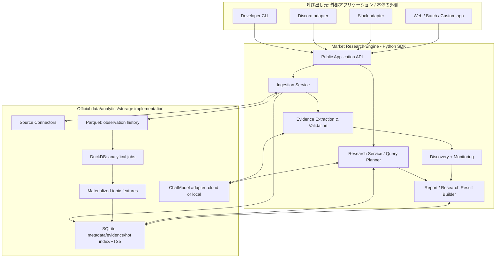

### 4.1 外部との境界

- **Input:** `ResearchQuery`, `CollectionSpec`, `AnalysisSpec`, `ReportSpec`。
- **Output:** `ResearchResult`, `TrendReport`, `JobResult`（JSONシリアライズ可能）。
- **Coreの責務:** 計画、抽出、検索、分析、検証、出典統合、操作結果。
- **外部Adapterの責務:** Discord Slash Command、Slackイベント、HTTP認証、表示、エンドユーザーのアクセス制御。

### 4.2 内部パッケージの依存方向

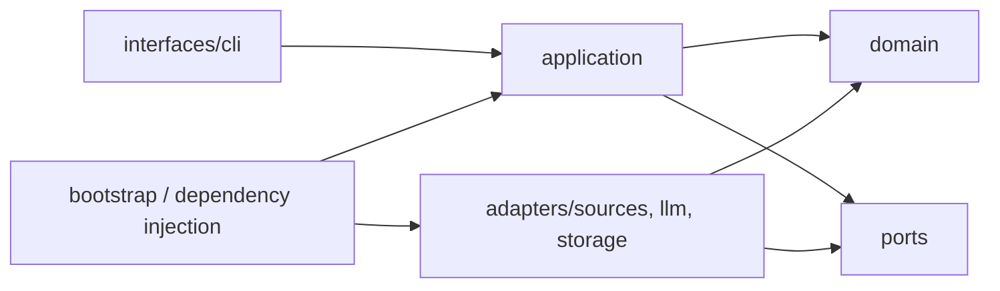

`domain` は外部SDK固有の型、DBアクセス、HTTP通信を持たない。Data/Storageは**標準実装を重点的に最適化**しつつPortを介して参照する。

---

## 5. データソースの選択と観測計画

### 5.1 6つの観測領域

| 領域 | 観測したいもの | 主な入力 | 提供価値 |
|---|---|---|---|
| SNS・カルチャー | 新しい行動、趣味、言葉、文化 | TikTok dataset、YouTube | 未知の流行を知る |
| 検索・関心 | 何が調べられているか | Google Trends（利用資格に注意） | 関心変化を補完 |
| 商品・アプリ | 新たに人気となる商品・サービス | 楽天、市場別ランキング | 消費行動の代理指標 |
| コミュニティ・不満 | 何が面倒、難しい、未解決か | HN / 条件付きReddit等 | 課題を調べる |
| 個人開発・新サービス | 新しい小規模プロダクト | GitHub、HN、条件付きProduct Hunt | 作り得るものの現実例を知る |
| 国内外比較 | 国や言語による差 | 複数ソースの同一対象 | 既知/未知の地域差を知る |

### 5.2 ソースの標準セット

| ID | ソース | v0.1適用 | 取得単位・分析例 | 注意 |
|---|---|---|---|---|
| `hackernews` | Hacker News Official API | **必須候補** | 投稿・コメント・スコア、Show/Ask HN | 技術者偏重 |
| `github` | GitHub REST API | **必須候補** | repo、topic、stars、Issues | Searchのレート・結果上限 |
| `youtube` | YouTube Data API | **第2スプリント候補** | video、mostPopular、statistics | 利用クォータ、取得可能な範囲 |
| `rakuten` | 楽天市場ランキングAPI | **第2スプリント候補** | 商品・ジャンル・順位 | 人気順位≠売上額 |
| `tiktok_batch` | datasocial TikTok dataset | **任意・別プロファイル** | Parquet / 日次×国別×タグ | 460GB級、非商用条件 |
| `producthunt` | Product Hunt API | 条件付き | Product、投稿、反応 | 非商用利用条件・認証 |
| `google_trends` | Google Trends API alpha | 条件付き | 検索関心 | 限定公開、一般必須依存不可 |

取得できるフィールド、公式URL、制約、初期頻度、欠測時の扱いは[DATA_SOURCE_MATRIX.md](./docs/DATA_SOURCE_MATRIX.md)を参照する。**未対応APIや権利上不確実な情報源をスクレイピングで代替することは既定動作にしない。**

### 5.3 Discovery と Monitoring を分離する

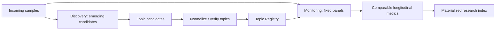

**Discovery:** 新着/ランキング/カテゴリ別の投稿、語句の共起、話題クラスタなどから、未知Topic候補を抽出する。未知候補の検出は基礎データの選択バイアスに影響されるため、収集設計を残す。

**Monitoring:** 過去から同じクエリ/カテゴリ/地域/時間窓で継続収集する。比較不能な期間は「上昇」と判定しない。

Topicの候補を見つける処理と、Topicの時系列を作る処理を混同しない。既知トピック偏重や、成長していない定番商品が常に上位になる現象を避ける。

### 5.4 Source Connector契約

```python
@dataclass(frozen=True)
class SourceCapabilities:
    periodic: bool
    search: bool
    batch: bool
    metrics_refresh: bool
    supports_region: bool

class SourceConnector(Protocol):
    @property
    def source_id(self) -> str: ...
    @property
    def capabilities(self) -> SourceCapabilities: ...
    async def collect(self, spec: CollectionSpec) -> AsyncIterator[RawRecord]: ...

# 検索をサポートするアダプターにのみ実装
class SearchableSource(Protocol):
    async def search(self, spec: SourceQuery) -> AsyncIterator[RawRecord]: ...
```

実装は `Capability` によって明示的に分岐する。`search()` を持たないソースへ無理にオンデマンド検索を要求しない。

### 5.5 CollectionSpecの標準化

`source_id`, `mode`, `region`, `language`, `categories`, `query_terms`, `window_start`, `window_end`, `max_items`, `sort_mode`, `cursor`, `collection_version`、呼び出し単位の `budget`（timeout, request cap, token cap）を定義。

同じクエリで取得した結果でも、ソースのアルゴリズムによる順位付け、APIの返却上限、キーワード検索の適用条件を記録しておく。これは厳密な時系列比較の前提である。

---
## 6. データ処理パイプライン

### 6.1 定期取得パイプライン

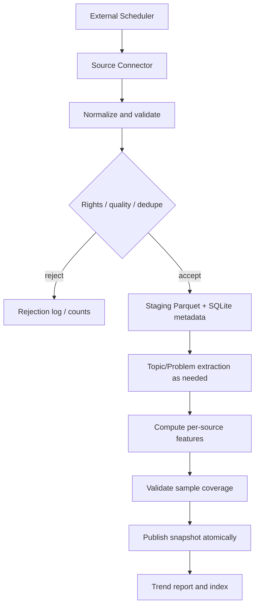

1. **Fetch:** API認証、条件、時刻、ページ、レート制限、原レスポンス識別子を記録。
2. **Normalize:** 出所固有のフィールド名を共通スキーマへ正規化。元の意味・単位を維持する。
3. **Dedupe:** `(source_id, external_id)` はRecordをupsertし、指標の新観測はappendする。
4. **Extract:** Topic分類、課題/行動/不満の抽出。すべてのデータにLLMを呼ばず、候補・変化・初出に絞る。
5. **Aggregate:** Sourceごとにトレンド指標計算。
6. **Validate:** カバレッジ、欠損、重複、統計的な比較可能性を検証。
7. **Publish:** 完成済みデータ・分析バージョンのみHot Indexへ公開。

### 6.2 On-demand調査

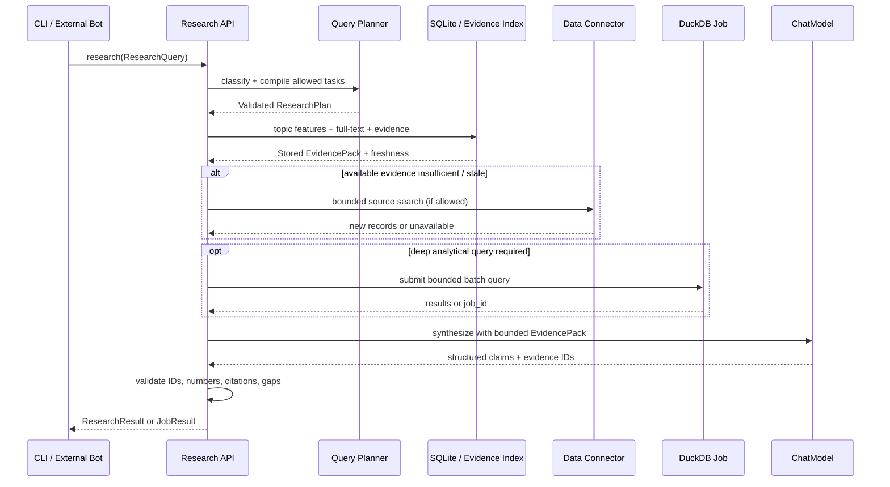

- Query Plannerはタスクの候補を返すだけであり、任意コード、任意SQL、未知の外部URLは実行しない。
- `read_policy`: `cached_only` / `refresh_if_stale` / `prefer_live` を指定できる。`prefer_live`でもAPIの利用資格と予算を超えない。
- Evidenceが不足する場合は `coverage_gap` と不足領域を列挙する。**未観測を需要がないという証拠にしない**。
- 長時間のバッチ分析は`accepted` + `job_id`を返す。CLIは `job status` でポーリング可能。

### 6.3 話題抽出における計算最適化

1. 語句・ハッシュタグ・説明文をルールベースで前処理し候補化。
2. 比較的小さなスパーステキストに対して軽量埋め込み/LLM分類（任意）。
3. 新規候補、判定難例、上昇候補を優先的にLLMへ渡す。
4. タイトル・本文・分類モデルバージョンのハッシュが一致するなら分類結果を再利用。
5. 再分類の影響があるTopic×Source×期間のみFeatureを再計算。

## 7. Evidenceを中心としたドメインモデル

### 7.1 概念ER図

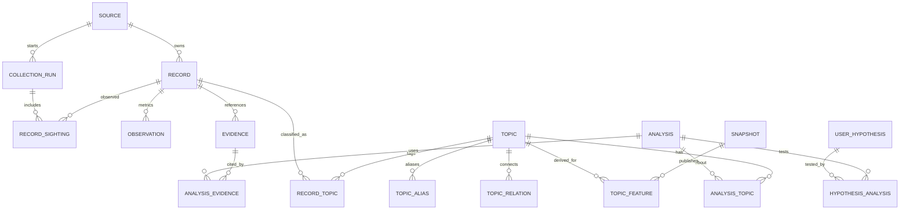

### 7.2 中心エンティティと必須プロパティ

| エンティティ | 識別キー | 必須の項目 | 説明 |
|---|---|---|---|
| `Source` | `source_id` | adapter/version, rights, docs URL | 情報源と取得権限 |
| `CollectionRun` | `run_id` | spec hash, time, coverage, status | 収集条件・失敗ページ・取得範囲 |
| `Record` | `record_id` | source_id, external_id, URL, published_at | 投稿・記事・サービスを表現 |
| `RecordSighting` | `(run_id, record_id)` | observed_in_run, order | どの収集実行で見つけたか |
| `Observation` | `observation_id` | metric, value/unit, observed_at | 収集時点の測定スナップショット |
| `Evidence` | `evidence_id` | record_id, claim_kind, text/value, source_locator | 出典を伴う最小主張 |
| `Topic` | `topic_id` | canonical_name, kind | 多言語の市場・話題 |
| `RecordTopic` | `(record_id, topic_id, version)` | method, confidence, verified | 多対多の関連付け |
| `TopicFeature` | 複合キー | topic, source, window, region, coverage, version | 事前計算した指標 |
| `Analysis` | `analysis_id` | method/version, computed_at, statement, limitations | Evidenceからの分析 |
| `Snapshot` | `snapshot_id` | data_version, status, published_at | 完成済み研究索引の単位 |
| `UserHypothesis` | `hypothesis_id` | question, owner/ref, created_at | ユーザーが提示した仮説（保存opt-in） |

**日時の定義**

- `published_at`: ソースで公開された時刻。元情報にない場合はnull。
- `observed_at`: 数値の状態が有効だった時刻。取得時刻と一致するとは限らない。
- `collected_at`: エンジンが取得した時刻。
- `computed_at`: 分析を実行した時刻。
- `period_start/end`: 統計の観測窓。全時刻はUTC、表示側でタイムゾーン変換。

**主張の定義**

- `observed_metric`: 直接取得された数値、ランキング、日時。
- `reported_statement`: 人が発言した内容。観測できるのは**発言の存在**であり真偽そのものではない。
- `documented_attribute`: ソースが明示する仕様・サービス説明等。
- `derived_analysis`: 計算・集約に基づく二次結果。
- `unknown`: 確認不能・部分取得・反証不足・データ不在。

詳細なSQLスキーマと制約は[DATABASE_DESIGN.md](./docs/DATABASE_DESIGN.md)。

## 8. Storageの最適化設計

### 8.1 データ温度別の責務

| 層 | 技術（基準案） | 保存するもの | 典型的なアクセス |
|---|---|---|---|
| Hot | SQLite + FTS5 | Topic辞書、Recordメタデータ、Evidence、最新の特徴量、Analyses、Jobs、Source権利 | ユーザーの質問・レポート参照 |
| Warm | Partitioned Parquet | 大量の`Observation`、履歴、再集計用ファクト | 週次集計・比較・再計算 |
| Compute | DuckDB | Parquet上の列指向クエリ、group by、join、窓関数 | 定期バッチまたは明示的詳細分析 |
| Cold | ユーザー管理データ/アーカイブ | 利用可能な生データ、大規模データセット | 必要時のみbatch import |

SQLiteとParquetを同じレコードの完全な二重コピーとするのではなく、**検索メタデータはSQLite、容量の大きい履歴はParquet** に保持し、必要な集計だけHotへ投影する。

### 8.2 質問→ストレージへのアクセスルーティング

| 質問 | 既定の読み先 | 高負荷が必要な場合 |
|---|---|---|
| 「最近の上昇トピック」 | SQLite `topic_features` | 基本不要 |
| 「〇〇という課題を語る人は？」 | `evidence` + FTS5 | 必要時だけ追加source search |
| 「前月と今月の比較」 | topic_featuresの異なるwindow | 未計算ならDuckDBジョブ |
| 「TikTokの全年度で〇〇は？」 | 既存の集計のみ | 許可済みParquet分析をジョブ化 |
| 「関連する情報源と元URL」 | `analysis_evidence`, `records` | 不要 |

### 8.3 書込と公開の整合性

SQLiteとParquetの横断原子トランザクションは前提にしない。**staging → manifest → materialize → publish**で状態遷移させる。

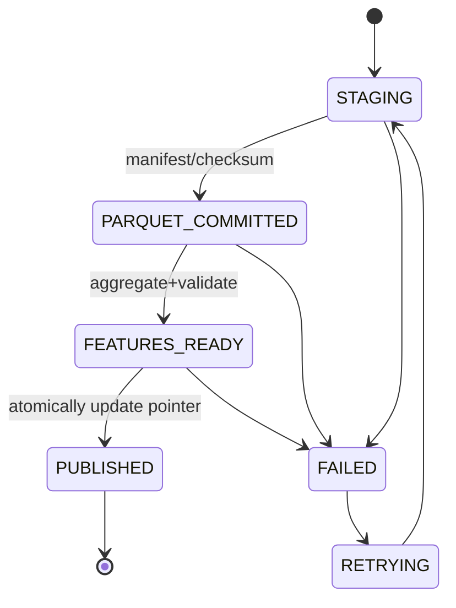

- `snapshot_id` ごとのFeatureを先に書き、最後のSQLiteトランザクションで公開ポインタを切り替える。
- 読み手は1つの`published_snapshot_id`を固定してから関連Feature/Analysisを読む。
- ロールバックは旧snapshotに戻す。後から期限切れsnapshotと未参照Parquetを回収する。
- Parquetは追記とファイル単位の差し替えを原則とし、共有ファイルを同時編集しない。
- SQLiteはWALモード、短い書込トランザクション、適切なcheckpoint/backupを使う。

### 8.4 物理最適化の方針

- **SQLite:** `(source_id, external_id)`一意制約、Topic→Recordの双方向インデックス、TopicFeatureの `snapshot_id/region/window/source` フィルタ索引。
- **FTS5:** タイトル・許諾された本文/抜粋・Evidenceテキストを検索。日本語はtrigram / 分かち書きによる精度評価を行う。原Recordと重複データの同期に注意。
- **Parquet:** Source×年月で始め、ファイルサイズと行グループを測定して結合。日次細分化は大量ソースのみ。
- **DuckDB:** 列選択・条件プッシュダウンを活用。巨大リモートファイルの初回スキャン時間は保証しない。
- **Cache:** `query + snapshot + analyzer_version + model_config` による結果キャッシュ。新しいデータ公開時に無効化する。
- **Future:** 多数の同時書込み・分散ワーカーが必要ならPostgres / object storage / worker queueへの移行を別ADRで検討する。

---
## 9. 分析アルゴリズム

### 9.1 Source-specific Feature → Cross-source Signal

まず各データソースに合った指標を計算し、後段でTopicを介して信号を関連付ける。

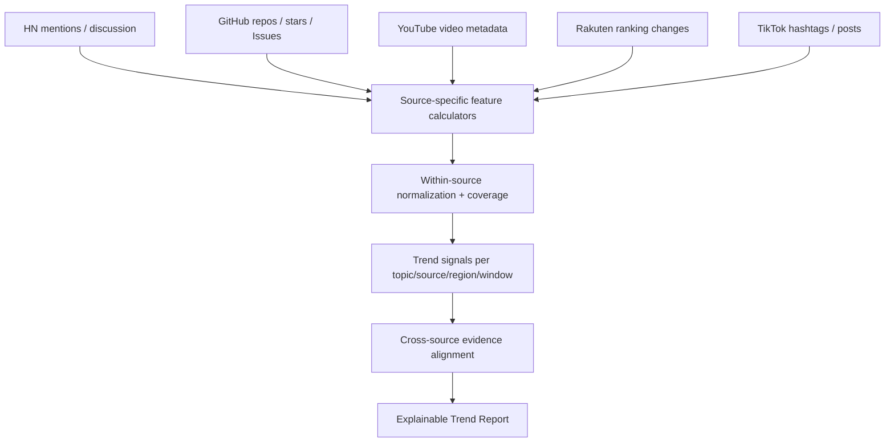

**原則:** 「GitHub 500スター」と「YouTube 10万再生」と「楽天ランキング5位」は単位が異なる。数値をそのまま足さず、それぞれの測定系における変化と独立した証拠の有無として評価する。

### 9.2 初期実装する分析器

| Analyzer | 最小入力 | 演算 | 出力 |
|---|---|---|---|
| `KeywordEmergence` | token/hashtag, period, coverage | 新規出現、最低件数フィルタ | emerging candidates |
| `MentionShareTrend` | matching count, eligible count, window | シェアの変化、低標本検査 | growth + sample size |
| `PopularityDelta` | 同一エンティティの観測履歴 | stars / views等の差分 | delta per source |
| `RankMovement` | 同じランキング系列の日時×順位 | 順位差、新規登場/離脱 | rank signal |
| `Persistence` | 固定条件での時系列 | 閾値超過継続期間 | persistence |
| `TopicClustering` | text/hashtags, embeddings optional | 候補類似度・ラベル付与 | TopicCandidate |
| `ProblemExtraction` | user posts/comments | actor/activity/friction抽出 | ReportedProblem + evidence |
| `RegionalComparison` | 比較可能な同指標×地域 | 相対差とCoverage検査 | region signal + limits |

### 9.3 トレンド数式（例・アルゴリズム案）

**カバレッジ補正した話題シェア**

\[
p_t = \frac{n_{\mathrm{topic},t}}{n_{\mathrm{eligible},t}}
\]

ここで `eligible` は当該固定取得設定で分析対象となった件数。ソース全体の投稿総量を意味しない。

**成長量（対数比）**

\[
G_t = \log \frac{p_t+\epsilon}{p_{t-k}+\epsilon}
\]

基準週の件数・同条件の検索範囲・最低件数を満たさない場合はnullとする。`epsilon` と窓幅は `analysis_version` に保存。

**加速度（例）**

\[
A_t = G_t-G_{t-k}
\]

**順位変動（例）**

\[
\Delta r_t=r_{t-k}-r_t
\]

`Δr > 0`は順位上昇。ただしランキング系列・ジャンル・対象リストが同一の場合に限る。

**継続性（例）**

\[
P = \frac{\#\{\mathrm{eligible\ windows\ with\ positive\ signal}\}}{\#\{\mathrm{eligible\ windows}\}}
\]

**Cross-source Breadth:** 同じTopicに対して、比較可能な期間内に独立した情報源から変化が観測された数を示す。母数・プラットフォーム間の相関・投稿のクロスポストを考慮しない生の「人数」ではない。

### 9.4 最低品質ゲート

- `sample_size` が設定値未満ならスコアを出さず `insufficient_data` にする。
- 収集ジョブが一部失敗した期間は前後比較の `comparability` を落とす。
- 一時的なバズと定着を区別するため継続観測窓を要件に含める。
- ソース内人気の変化は、販売成長・市場の需要の増加と同じ意味ではない。
- マルチソースの同時上昇を「因果関係」と断定しない。
- トレンドの分類は `observed`, `candidate`, `weak_evidence`, `insufficient_data` を持つ。

### 9.5 課題・不満の抽出

LLMは投稿から構造化情報を抽出する。実際に存在する課題の証明と、課題についての**報告**を区別する。

```json
{
  "type": "reported_problem",
  "actor": "初心者ユーザー",
  "activity": "3Dモデルの作成",
  "friction": "操作習得に時間がかかると投稿者が述べた",
  "evidence_ids": ["ev_sample_01"],
  "scope_note": "単一投稿であり一般化できない",
  "model_version": "extractor-v1"
}
```

上記は**架空の出力例**。引用や抜粋は保持できる利用条件に従い、可能なら原文への位置情報を持つ。

### 9.6 TikTok大規模データセット（任意）

- データセットカードの確認値: **5,598,141,717行、約460GB**、月別Parquet、`cc-by-nc-4.0`。
- 有用列: `video_id`, `posted_at`, `country`, `language`, `caption`, `hashtags`, `on_screen_text`, `views`, `likes`, `shares`, `saves`, `stats_updated_at`。
- `country`は投稿側の動画地域属性であり、その地域のユーザーが何人視聴したかを表さない。
- `mentions`は言及されたアカウントの配列で、投稿者の一意IDとして使用しない。
- 反応値は`stats_updated_at`時点の値であり、同じ動画を複数時点で再取得しなければ視聴増加速度は測れない。
- 研究目的に必要な列と年月だけを選択する。全量ダウンロードをMVP必須にしない。
- OSSホイールやリポジトリにデータを入れず、利用者管理下のストレージに接続する。
- 現行API相当のリアルタイム継続収集源と誤認しない。

---

## 10. LLMと検索の接続

### 10.1 LLMの責務分離

| 機能 | 基本実装 | LLMの役割 |
|---|---|---|
| データ収集 | Connector | 使用しない |
| 差分計算・統計 | DuckDB/Python | 使用しない |
| Topic候補化 | rules + LLM optional | 意味分類・曖昧さの解消 |
| 課題抽出 | LLM | actor/activity/frictionを構造化 |
| Query Planning | LLM + allowed task list | 意図を安全なタスクへ変換 |
| Retrieval | SQL/FTS/optional semantic index | 検索語・意味的拡張の補助 |
| Answer Synthesis | LLM + EvidencePack | 根拠の内容を説明 |
| Evidence validation | deterministic checks + review | 最小限の補助、単独真偽判定に使わない |

### 10.2 モデルPort

```python
class ChatModel(Protocol):
    @property
    def capabilities(self) -> ModelCapabilities: ...
    async def generate_structured(
        self, messages: list[Message], schema: type[T], budget: LLMBudget
    ) -> T: ...

class EmbeddingModel(Protocol):  # v0.1では任意
    async def embed(self, texts: list[str]) -> list[list[float]]: ...
```

- 初期Provider: OpenAI-compatible / Ollama（部分互換、サポート機能はモデル別検証） / Fake LLM for tests。
- API型でもローカル型でも、Coreが受け取るのはPydantic互換のドメイン型。
- JSON schema未対応モデルは検証付き再プロンプト/テキストパーサへフォールバックするか、能力不足をエラーにする。
- 各処理に時間・トークン・再試行回数の上限を設ける。

### 10.3 調査計画の型（例）

```json
{
  "intent": "hypothesis_evidence",
  "query": "3Dプリンター初心者はCAD操作に困っているのでは？",
  "topic_candidates": ["consumer-3d-printing", "cad-learning"],
  "regions": ["JP"],
  "lookback_days": 90,
  "tasks": ["search_reported_problems", "search_counter_examples"],
  "read_policy": "refresh_if_stale",
  "budgets": {"max_records": 300, "timeout_sec": 20}
}
```

検証済みの有限タスク以外は実行しない。`lookback_days`はデフォルト案であり、元質問に期間があればそちらを優先する。

### 10.4 Evidence Pack → 最終回答

1. `EvidenceResolver`が根拠のIDと取得/公開時点を解決。
2. `FactTable`は数字・ソース属性をコードで確定。
3. `AnswerSynthesizer`が `finding_type`, `statement`, `evidence_ids`, `limitations` を構造化生成。
4. `AnswerValidator`が存在しないEvidence ID、数字の不整合、出典なし断定を検出。
5. 補修できない場合はその主張を落とすか `unknown` として返す。

```json
{
  "schema_version": "1.0",
  "query": "日本の3Dプリンター市場は今どう？",
  "status": "completed",
  "data_freshness": "partial",
  "findings": [
    {
      "type": "derived_analysis",
      "statement": "例: 対象サンプル内で一部の関連話題の比率が上昇",
      "evidence_ids": ["ev_001", "ev_002"],
      "limitations": ["対象カテゴリに限定", "国内市場全体は不明"]
    }
  ],
  "unknowns": ["未観測の販路における実際の購入者数"],
  "evidence": [
    {
      "id": "ev_001",
      "source": "example_source",
      "url": "https://example.com/source",
      "published_at": null,
      "collected_at": "2026-10-22T00:00:00Z"
    }
  ],
  "snapshot_id": "snapshot_example"
}
```

> このJSONは**設計上の架空例**であり、3Dプリンター市場を実際に調査した結果ではない。

### 10.5 問合せの結果ステータス

| status | 意味 | 呼び出し元の処理 |
|---|---|---|
| `completed` | 調査回答あり | 表示・保存 |
| `partial` | 一部のソース/処理が未完了 | 制約と完成部分を表示 |
| `accepted` | バッチジョブ開始 | `job_id` で状態確認 |
| `insufficient_evidence` | 適切な根拠が不足 | 未確認を明示 |
| `unavailable` | 機能/資格/ソース利用不可 | 設定を確認 |
| `failed` | 内部エラー | error_codeとrun_idで診断 |

システムエラーと「データから判断不能」は混同しない。

---
## 11. 公開SDK / CLI / 配布仕様

### 11.1 Python SDKの呼び出しイメージ

```python
from market_research import ResearchEngine, ResearchQuery

# 実際の公開API仕様としての例であり、未実装
engine = ResearchEngine.from_config("config.yaml")
result = await engine.research(
    ResearchQuery(
        question="日本の個人向け3Dプリンター市場は今どんな感じ？",
        regions=["JP"],
        read_policy="refresh_if_stale",
    )
)

for finding in result.findings:
    print(finding.type, finding.statement, finding.evidence_ids)
```

### 11.2 CLIの操作設計

```bash
market-research doctor
market-research sources list
market-research collect --source hackernews --since 2026-10-01
market-research collect --profile consumer
market-research analyze trends --window 7d --region JP
market-research report weekly --format json --output report.json
market-research ask "日本で最近注目される趣味は？" --format json
market-research ask "初心者のCAD習得は障壁か？" --format markdown
market-research job status <job-id>
market-research db stats
market-research benchmark retrieval --fixture medium
```

**設計原則:** CLIはSDKの薄いラッパー。TTYの色付けや表の形式はCLI側だけに存在し、Coreは構造化データを返す。初期のCLIは同期完結の短い問い合わせとジョブ参照を優先し、チャット風の連続プロンプトはoptional。

### 11.3 OSSパッケージ構造

```text
market-research-engine/
├── src/market_research/
│   ├── domain/          # Source, Record, Topic, Evidence, Analysis
│   ├── ports/           # Connector, Storage, ChatModel, Search
│   ├── application/     # Research, Ingestion, Discovery, Monitoring
│   ├── adapters/
│   │   ├── sources/     # HN, GitHub, YouTube, Rakuten, TikTok batch
│   │   ├── storage/     # SQLite, Parquet, DuckDB
│   │   ├── llm/         # OpenAI-compatible, Ollama, Fake
│   │   └── search/      # SQLite FTS, optional embeddings
│   ├── analytics/       # features, anomaly, persistence, problems
│   ├── indexing/        # snapshot materialization
│   ├── interfaces/cli/  # thin adapter
│   └── bootstrap.py     # dependency injection
├── tests/
│   ├── fixtures/
│   ├── unit/
│   ├── contract/
│   ├── integration/
│   └── evaluations/
├── benchmarks/
├── examples/
├── docs/
├── pyproject.toml
├── config.example.yaml
├── LICENSE
├── DATA_POLICY.md
├── THIRD_PARTY_SOURCES.md
└── README.md
```

構成は単一パッケージのモノレポを基本とし、初期段階からマイクロサービス分割しない。

### 11.4 構成プロファイル

| profile | データの初期設定 | 主要用途 |
|---|---|---|
| `lite` | HN + GitHub | すぐに試せるOSS/開発者市場 |
| `consumer` | YouTube + 楽天（キー設定後） | 消費者トレンドを観測 |
| `research` | TikTok等のユーザー所有Parquet | 大規模バッチ研究 |
| `custom` | ソース単位で選択 | コミュニティ拡張 |

`full` は全データの自動提供を意味する名前にしない。取得権限のあるソースのみを有効化する。

### 11.5 設定例

```yaml
profile: lite
storage:
  sqlite_path: ./data/market.db
  parquet_root: ./data/observations
  snapshot_policy: published_only
collection:
  enabled_sources: [hackernews, github]
  budget:
    max_requests_per_run: 100
    timeout_sec: 120
analysis:
  windows_days: [7, 30]
  min_observations: 10  # 実測評価で調整
  topic_extraction_mode: hybrid
research:
  read_policy: refresh_if_stale
  max_evidence_items: 30
  max_task_depth: 4
llm:
  adapter: openai_compatible  # 例: ollama HTTP endpoint
  base_url: http://localhost:11434/v1
  model: configured-model
  structured_output: auto
```

秘匿情報はconfigファイルに直書きせず、環境変数またはシークレットマネージャーから取得する。

---

## 12. 性能・リソース・スケーリング

### 12.1 レイテンシー計測対象

| 処理 | p95暫定目標（未実測） | 測定条件の例 |
|---|---|---|
| Hot TopicFeature検索 | 100ms以内 | 直近snapshot、固定Top-K |
| Evidence FTS検索 | 300ms以内 | 100万Evidence相当のFixture |
| LLM手前のローカルRetrieval | 1秒以内 | キャッシュ有無を区別 |
| LLM回答生成 | モデル・環境別に記録 | Cloud/Localを分けて計測 |
| コールドParquet分析 | 固定SLOなし | 処理量・ファイル構成・デバイス別に測る |

この値は目標であって達成済みの性能ではない。小型Mac/標準SSDでのベンチマークを採用判定に使う。

### 12.2 最適化レバー

- **入力削減:** 対象期間、列、地域、カテゴリ、サンプル上限、索引の使用。
- **事前集計:** 公開snapshotにTopic×Source×Region×Windowをマテリアライズ。
- **差分更新:** 更新されたRecordとObservationだけ再処理。
- **LLM節約:** 重複テキストの分類キャッシュ、限られた候補だけ意味分類。
- **バッチ分離:** TikTok等巨大ファイルの処理は非同期ジョブ化。
- **ファイル最適化:** 多数の小Parquetを定期的にcompact。
- **可観測性:** `run_id`, `snapshot_id`, `source_request_count`, `rows_in/out`, `query_ms`, `llm_tokens`, `cache_hit` を測定。

### 12.3 スケールアップのトリガー

次のいずれかが継続して観測される場合にStorage/Queueの見直しを行う。

- Hot DBのread p95目標が索引・キャッシュ最適化後も満たせない。
- 書き込み並列度がSQLiteのwriter制約に抵触する。
- バッチ分析のメモリ・SSD容量が個人PCの運用範囲を超える。
- 複数ホストから同じストレージを同時更新する必要が発生。

**拡張案:** PostgreSQL、S3互換のオブジェクトストレージ、ワーカーキュー、専用検索エンジン。初期導入はしない。

## 13. テスト戦略と評価方法

### 13.1 テスト階層

| 階層 | テスト対象 | 原則 |
|---|---|---|
| Unit | 正規化、日時、計算式、トピック統合規則 | 外部依存なし |
| Contract | SourceAdapter、Storage、LLM Port | Fake/Fixtureで再現 |
| Integration | 収集→保存→特徴量→回答 | Fake LLM、ローカルSQLite |
| Data Quality | 欠損、取得範囲、重複、順位の変化 | 失敗を明示できること |
| Evaluation | 根拠付き回答、支持/反証/不明 | 人手評価 + 自動検査 |
| Performance | SQLite / FTS / DuckDB / memory | データ規模ごとのp50/p95 |
| Live smoke | 実API・実LLM | 環境変数があるときだけ明示実行 |

### 13.2 必須の境界シナリオ

- ある週のAPI収集が半分失敗した場合、見かけの減少を実際の市場縮小と判定しない。
- 外部ソースの投稿日が欠ける場合、取得時刻で上書きせずnullにする。
- 星数・再生数が0、null、更新後に減少した場合の扱いを統一する。
- 同じRecordを2回収集してもRecord件数が増えずObservationは同じ測定時点なら二重化しない。
- 海外Topicと国内Topicの同一性が曖昧なら、比較不能を返す。
- 「反証情報がない」を「支持確定」と言い換えない。
- LLMが架空のEvidence IDや数値を返しても出力を拒否する。
- バッチ処理が中断しても前回の公開済みsnapshotを返せる。
- 生データに「この命令を実行せよ」が含まれていてもツール呼出しを増やさない。

### 13.3 評価指標

- 根拠対応率: Evidenceを付した主張のうち実際に支持するものの割合。
- 数値整合率: 出力した数字・期間・単位がFeature/Recordと一致する割合。
- 反証探索率: 仮説検証質問で反証・代替説明を探索した割合。
- 欠損判定精度: 不十分なデータのとき適切に留保できるか。
- Discovery有効率: 観測結果から人間が「新しく知った・掘り下げたい」と評価した比率。
- システム指標: collection error rate、lag、SQLite/FTS p95、LLM待ち時間、Token/call。

評価セット例とベンチマーク手順は[EVALUATION_AND_TEST.md](./docs/EVALUATION_AND_TEST.md)。

## 14. 法務・セキュリティ・OSS公開

### 14.1 コードとデータの権利

- ソフトウェアコード: Apache-2.0またはMITのうち公開前に確定。OSSとして商用再利用可能なライセンスを選ぶ（**非商用のデータ利用条件をコードに継承しない**）。
- データ: ソースごとの権利を個別管理。多くのAPIには利用制限、レート、保存/再配布条件がある。
- TikTok `datasocial/tiktok-5.6B-videos`: CC BY-NC 4.0、帰属表示や非商用条件を確認。データ再配布せず任意import。
- Product Hunt API: 原則商用不可（利用条件は変更され得る）。有効化時に確認。
- Google Trends API: 2026-10-22時点でアルファ版の限定アクセスとして案内。必須依存にしない。

### 14.2 外部情報の取扱い

- ソースAPI条件に従い収集し、必要以上の全文・アカウント情報・プロフィール情報を保存しない。
- 利用者の仮説・会話履歴は既定では保存しないか、保存する場合は明示的に設定する。
- ログにAPIキー、認証ヘッダ、秘密の問い合わせを出さない。
- 外部投稿は未信頼入力としてLLMに渡し、命令として実行しない。
- Collectorプラグインは任意コードのため明示的opt-inで読み込む。
- ソースの削除・ライセンス変更時に対象レコードを特定・削除・再計算できるようにする。

### 14.3 配布の必須ファイル

`README.md`, `LICENSE`, `SECURITY.md`, `CONTRIBUTING.md`, `THIRD_PARTY_SOURCES.md`, `DATA_POLICY.md`, `config.example.yaml`, `docs/connector-guide.md` 等。外部データの権利関係は常に利用時点で再検証する。

---

## 15. 実装ロードマップ・完了条件

| マイルストーン | 実装範囲 | 受入基準 |
|---|---|---|
| M0: Foundation | ドメイン型、Port、CLI、SQLiteマイグレーション、Fake Adapter | `doctor`/fixture調査がAPIキー無しで動作 |
| M1: Collect & Store | HN + GitHub、収集履歴、Record/Observation/Evidence | 冪等取得、出典を追跡、履歴を蓄積 |
| M2: Analytics | Discovery/Monitoring、Topic、特徴量、Parquet/DuckDB、snapshot | 有効なトレンドと比較不能が区別される |
| M3: Research | Query Planner、SQL/FTS、Answer Synthesizer、ローカル/Cloud LLM | 市場概況・仮説調査がEvidence付きでCLI回答 |
| M4: Consumer Sources | YouTube・楽天、地域別分析、レポート | Consumer Topicで情報源の差異を適切に説明 |
| M5: OSS Release | CI、性能評価、設定例、ライセンス、ユーザーガイド | クリーン環境でインストール・テスト可能 |
| M6: Optional Batch | TikTok importer、容量/権利ガード、部分Parquet分析 | 少数月/地域で再現可能、同梱無し |

### 15.1 MVPのスコープを最小化するなら

**最小縦断シナリオ:** HN + GitHub → SQLite → Topic抽出 → 7/30日Feature → FTS検索 → Cloud/LocalいずれかのLLM → CLIから出典付き回答。

この時点では「日本の消費者トレンド全体が分かる」とは主張しない。M4以降で領域を拡げる。

### 15.2 MVP完了のDoD

- SDKはPythonから呼び出し可能、CLIは`--format json`対応。
- データ取得時のソース・クエリ・期間・制限・エラーを追跡できる。
- 少なくとも2ソースから10日以上の観測実験を行い、差分を保存。
- Topicに紐づく指標の計算と、正しい日時・期間表示ができる。
- すべての数値主張にはソースを辿れるIDがある。
- Fake LLMの統合テストがインターネット/APIキーなしで通る。
- 観測不足の市場質問に対し「判断不能」を返せる。
- 標準構成のp95/リソース利用を実測し、ベンチマーク結果を公開する。
- データ利用条件と本体OSSライセンスが明確に分離されている。

## 16. 残る未決事項と意思決定ゲート

| 論点 | 現段階 | 決定に必要なもの |
|---|---|---|
| SQLite + Parquet + DuckDBの最終確定 | **Proposed** | 100万件級のデータとp95測定、障害時リカバリ検証 |
| 最初に有効化する各API | **候補** | 認証・rate limit・利用条件・対象地域の確認 |
| Topicの自動統合閾値 | **未決** | 日本語/英語の同義/類似コーパスの人手評価 |
| 伸び率・継続性の閾値 | **未決** | Sourceごとの基準分布と偽陽性率の評価 |
| LLMの最低サポート仕様 | **未決** | JSON構造化・エラー・Context長の比較試験 |
| Embedding検索の導入 | **Optional** | FTS5で不足する質問を測定 |
| SDK名・PyPI名・コードライセンス | **未決** | パッケージ名称の重複調査と公開方針 |
| 個人の仮説履歴の保存 | **opt-in案** | プライバシーとユーザビリティ要件の確定 |
| 巨大Parquetバッチの標準範囲 | **研究用オプション** | 小規模部分実験・メモリ/時間/権利検証 |

## 17. ADRとの対応

| 設計章 | 主要ADR |
|---|---|
| 1–3: 目的・範囲 | [0001](./adr/ADR-0001-product-goals-and-boundaries.md), [0002](./adr/ADR-0002-headless-core.md) |
| 5–6: 情報源・取得 | [0003](./adr/ADR-0003-source-selection-and-ingestion.md), [0004](./adr/ADR-0004-tiktok-optional-batch.md), [0016](./adr/ADR-0016-discovery-vs-monitoring.md) |
| 7: 根拠・Topic | [0005](./adr/ADR-0005-evidence-provenance.md), [0006](./adr/ADR-0006-topic-identity.md) |
| 8: Storage | [0008](./adr/ADR-0008-storage-materialization.md), [0011](./adr/ADR-0011-jobs-consistency-and-scheduling.md) |
| 9: 分析 | [0007](./adr/ADR-0007-source-aware-analytics.md) |
| 10: 調査/LLM | [0009](./adr/ADR-0009-research-query-routing.md), [0010](./adr/ADR-0010-llm-boundaries.md) |
| 11–15: 公開/品質 | [0012](./adr/ADR-0012-oss-license-and-data-rights.md), [0013](./adr/ADR-0013-quality-tests-and-benchmarks.md), [0014](./adr/ADR-0014-scalability-and-packaging.md), [0015](./adr/ADR-0015-security-privacy-and-prompt-injection.md) |

## 18. 参考資料（確認日: 2026-10-22）

1. [Hacker News Official API](https://github.com/HackerNews/API)
2. [GitHub Search API](https://docs.github.com/en/rest/search/search)
3. [GitHub REST API rate limits](https://docs.github.com/en/rest/using-the-rest-api/rate-limits-for-the-rest-api)
4. [YouTube videos.list](https://developers.google.com/youtube/data/reference/rest/v3/videos/list)
5. [YouTube quota calculator](https://developers.google.com/youtube/data/determine_quota_cost)
6. [楽天市場ランキングAPI](https://webservice.rakuten.co.jp/documentation/ichiba-item-ranking)
7. [Hugging Face TikTok 5.6B videos](https://huggingface.co/datasets/datasocial/tiktok-5.6B-videos)
8. [Product Hunt API](https://api.producthunt.com/v2/docs)
9. [Google Trends API alpha](https://developers.google.com/search/apis/trends)
10. [SQLite WAL](https://sqlite.org/wal.html)
11. [SQLite FTS5](https://sqlite.org/fts5.html)
12. [DuckDB Parquet](https://duckdb.org/docs/lts/data/parquet/overview)
13. [Ollama OpenAI compatibility](https://docs.ollama.com/api/openai-compatibility)
14. [CC BY-NC 4.0](https://creativecommons.org/licenses/by-nc/4.0/)

**注:** ソースの規約やAPI仕様は変更される。上記は2026-10-22時点の設計根拠であり、実装・公開・再配布時には最新条件を再確認する。


---

<!-- 元のファイル: docs/DATA_SOURCE_MATRIX.md -->

# Data Source設計マトリクス

- **版:** v1.0 / 2026-10-22
- **位置付け:** [最終設計書](../PRODUCT_DESIGN.md)・[ADR-0003](../adr/ADR-0003-source-selection-and-ingestion.md) の補足
- **注意:** 各プラットフォームの仕様・利用許可・料金体系は変わり得る。明示したAPI契約以外の自動取得を保証しない。

## 1. 必要な観測を先に定義する

| Signal | Inputの必要条件 | 観測できること | 観測できないこと |
|---|---|---|---|
| Topic Appearance | タイトル、本文、タグ、公開日 | 話題が出現した | 市場全体の知名度 |
| Mention Growth | 固定条件の新着検索結果、集計母数 | 当該取得系列での相対的な増減 | 全インターネットの投稿増 |
| Engagement | 同一IDの複数観測時点での計数 | サンプルの反応の増減 | 有料顧客数・購買意向 |
| Ranking Movement | 同一ジャンル・同一ルールの順位スナップショット | ランキング内の順位推移 | 売上規模（取得できない場合） |
| Reported Friction | コメント、レビュー、Issue等の文章 | 困りごとに関する発言 | それが全体に広く存在する事実 |
| New Tool | 新規repo/投稿/製品 | ツールの登場と公開時点 | 実ユーザー数・利益 |
| Region Difference | 同様に定義した国・地域別のサンプル | サンプル上の地域差 | 各国人口における普及率 |

## 2. 採用候補ソースの具体仕様

### 2.1 Hacker News / 初期必須候補

- **取得:** [公式Firebase API](https://github.com/HackerNews/API)（top/new/show/ask、item情報）。
- **必要フィールド:** `id`, `type`, `time`, `title`, `text`, `url`, `score`, `descendants`, `kids`（存在する場合）。
- **処理:** `Record`（story/comment）、`Observation`（score, descendants）、`Evidence`（ユーザーの発言、文章の最小引用）、Topic候補。
- **検出:** 初登場の新サービス、開発者の不満、議論される技術の変化。
- **収集設計:** New/Show/Ask別に収集。既知IDのコメント/スコアを必要な期間のみ再取得。コメント木の深さ・取得件数を制限。
- **Coverage:** endpoint, fetched_ids, requested_at, max_items, missing_items, timeout, collection_window。
- **注意:** HNのユーザー層は偏っており、消費市場全体の代表ではない。レポートには「HNの観測で」と記す。

### 2.2 GitHub / 初期必須候補

- **取得:** [REST API](https://docs.github.com/en/rest) のRepo/Search/Issue等（認証が必要な条件あり）。
- **必要フィールド:** `full_name`, `id`, `created_at`, `pushed_at`, `stargazers_count`, `topics`, `description`, `html_url`。Issueを調べる場合は`number`, `title`, `body`, `created_at`, `state`等。
- **処理:** RepoをRecord、星数をObservationとして追記。Issueは別Recordにして課題の報告を抽出。
- **検出:** 新しいOSS分野、個人開発ツール、最近関心を集めるrepo群、実際に議論される開発課題。
- **Coverage:** Search query, sort, page, api version, result cap, rate-limit, query_time。
- **制約:** GitHub検索APIは検索結果上限と専用レート制限がある（公式ドキュメントでは検索結果最大1,000件、一般検索で認証時30回/分、未認証10回/分と案内）。非網羅であることを記録する。
- **注意:** Starsの増加は利用者数・商用売上ではない。Issuesの不満は特定ユーザーの報告。

### 2.3 YouTube / Consumerプロファイル候補

- **取得:** [Videos:list](https://developers.google.com/youtube/data/reference/rest/v3/videos/list) で `chart=mostPopular` + `regionCode`、`statistics`、必要な範囲で[Search:list](https://developers.google.com/youtube/data/reference/rest/v3/search/list) を検討。
- **必要フィールド:** `video_id`, `publishedAt`, `title`, `description`（条件に従う）, `tags`, `categoryId`, `viewCount`, `likeCount`（提供される場合）, `regionCode`（リクエスト設定）。
- **処理:** Video単位Recordと再生数Observation、Topic候補、ランキング等の取得時点データ。
- **検出:** 特定地域の人気コンテンツ、ジャンルの注目、動画群の反応推移。
- **Coverage:** query/chart, region, category, ordered returned IDs, paging, quota usage, timestamp。
- **注意:** `regionCode`は呼び出したチャート対象地域であり、個々の視聴者の地域とは限らない。動画メタデータは現実の購買や行動を直接証明しない。
- **API変更注意:** [quota公式表](https://developers.google.com/youtube/data/determine_quota_cost)で現在のバケットと単価・上限を確認する。旧来の`search.list=100 units`等の説明をハードコードしない。リクエストBudgetを設定値にする。

### 2.4 楽天市場ランキング / Consumerプロファイル候補

- **取得:** [Ichiba Item Ranking API](https://webservice.rakuten.co.jp/documentation/ichiba-item-ranking)（version 2022-06-01）。
- **必要フィールド:** 商品ID、商品名、ジャンル、順位、取得時刻、必要に応じ公開価格・リンクなど許諾された属性。
- **処理:** 商品Record + genre/date別RankObservation。新規ランクイン、順位上昇・離脱。
- **Coverage:** genre, age, sex等のフィルタとランキング対象窓、取得件数、要求日時。
- **制約:** ID/認証条件、アフィリエイト・キャッシュ・表示ルールなどは公式規約を遵守。
- **注意:** ランク変動は当該ランキング内の相対的な動き。売上や消費者全体の需要とは断定しない。

### 2.5 TikTok 5.6B Dataset / Researchオプション

- **配布:** [Hugging Face Dataset](https://huggingface.co/datasets/datasocial/tiktok-5.6B-videos)、約5,598,141,717件、約460GB、月別Parquet。
- **カラム:** `video_id`, `posted_at`, `country`, `language`, `type`, `caption`, `hashtags`, `on_screen_text`, `views`, `likes`, `comments`, `shares`, `saves`, `stats_updated_at`ほか。
- **処理:** 配布者・利用者管理のParquetからDuckDBで必要列/期間のみ読込。`post_day×country×hashtag`集計を試し、Featureと標本数を保存。
- **初期検証:** 1か月・少数の地域の範囲で複数ハッシュタグについて計算。必要に応じ月別Parquetの部分読み取りを利用。
- **注意:** `country`は動画の地域属性で視聴者の所在ではない。投稿者IDを一意に指すカラムが明示されていないため、Unique Creator分析を前提にしない。統計値は`stats_updated_at`時点。
- **鮮度:** 公開ファイルはスナップショットとして扱う。日次更新の保証はない。ライブトレンド推定に直結させない。
- **権利:** `cc-by-nc-4.0`。非商用条件と表示義務、プラットフォーム条件を利用者に明示。アーカイブのホイール同梱・再配布は行わない。
- **失敗モード:** メモリ不足/ストレージ不足/地域欠損/古い動画のゼロ値/規約未確認 → featureは出さず通知。

### 2.6 条件付き/調査候補

| ソース | 状態 | 利用可能性に対する注意 |
|---|---|---|
| [Product Hunt API](https://api.producthunt.com/v2/docs) | opt-in | 認証が必要、原則商用目的でのAPI使用は禁止。利用目的の確認が必要 |
| [Google Trends API](https://developers.google.com/search/apis/trends) | alpha / opt-in | 申請制の限定API。UI上で見られるからといって機械取得権限があるわけではない |
| Reddit | 未採用 | API・利用条件・データ保持の権利を別途検証してから追加 |
| TikTok Creative Center | 手動補完候補 | 公開画面での観測と公式APIの存在を混同しない |
| Bluesky/Jetstream | 将来候補 | 高頻度ストリームの常時接続・継続稼働の必要性を検討 |
| App Store/Pinterest/Amazon | 将来候補 | 提供条件を確認し、公式許容範囲から設計する |

## 3. SourceContractの例

```yaml
source_id: youtube
version: 1
adapter: official_api
capabilities:
  periodic: true
  search: true
  batch: false
  metrics_refresh: true
coverage:
  sampling_method: chart_or_query_results
  market_representative: false
  region_meaning: requested_chart_region
metrics:
  view_count:
    unit: count
    can_change: true
    observed_at_required: true
collection:
  max_items_per_run: 500
  retry_policy: exponential_backoff
rights:
  requires_user_credentials: true
  raw_redistribution: false
  terms_url: https://developers.google.com/youtube/v3
```

値は設計用設定例。制約は正式な条件確認とテスト後に実装する。

## 4. Source採用ゲート

1. 公式API・公開ファイル・契約上利用できる取得経路が存在する。
2. 必要な時刻/地域/検索条件/数値の意味が分かる。
3. 同じCollectionSpecで複数時点を比較可能。
4. 欠損・取得上限・レート・権利条件を記録できる。
5. 配布するコードと取得データを分離できる。
6. 通常のユニットテストは外部サービスなしで実行できる。

上記を満たさないソースは **source status = experimental / manual / disabled** として扱う。


---

<!-- 元のファイル: docs/DATABASE_DESIGN.md -->

# Database / Materialization詳細設計

- **版:** v1.0、2026-10-22
- **対象:** ローカル標準実装 `SQLite + Parquet + DuckDB` （ADR-0008の**性能検証前の提案**）
- **前提:** 単一インスタンスまたは小規模利用、SQLiteへの書込経路を制御、DuckDBは分析ジョブ側で利用。

## 1. 主要アクセスパターン

| Query ID | 想定SQLアクセス | 頻度 | 最適化 |
|---|---|---|---|
| Q1 | 指定期間・地域の上昇Topic Top-K | 高 | `topic_features`のsnapshot/地域/期間索引 |
| Q2 | TopicごとのEvidenceとURL | 高 | `record_topics` + `evidence` + `records` join |
| Q3 | 「〇〇が課題？」の全文検索 | 高 | FTS5（日本語精度は評価） |
| Q4 | 同一Topicの複数時点を比較 | 中 | Source/Region/WindowでのFeature参照 |
| Q5 | 数値の詳細履歴の再集計 | 低/重 | ParquetとDuckDBで非同期処理 |
| Q6 | 収集履歴/欠損や取得上限の監査 | 中 | `collection_runs`索引 |
| Q7 | 分析結果の根拠を全件辿る | 中 | `analysis_evidence`の両方向索引 |

## 2. SQLite物理スキーマ案

以下は**ベースラインDDLの抜粋**。本番実装前にmigration、SQL制約、UUID生成方式と大規模実行計画を検証する。

```sql
PRAGMA foreign_keys = ON;
PRAGMA journal_mode = WAL;
PRAGMA busy_timeout = 5000;

CREATE TABLE sources (
    source_id TEXT PRIMARY KEY,
    adapter_version TEXT NOT NULL,
    docs_url TEXT NOT NULL,
    rights_json TEXT NOT NULL,
    capabilities_json TEXT NOT NULL,
    enabled INTEGER NOT NULL DEFAULT 0 CHECK (enabled IN (0,1)),
    last_reviewed_at TEXT NOT NULL
);

CREATE TABLE collection_runs (
    run_id TEXT PRIMARY KEY,
    source_id TEXT NOT NULL REFERENCES sources(source_id),
    collection_spec_json TEXT NOT NULL,
    collection_spec_hash TEXT NOT NULL,
    status TEXT NOT NULL,
    started_at TEXT NOT NULL,
    finished_at TEXT,
    fetched_count INTEGER NOT NULL DEFAULT 0,
    error_count INTEGER NOT NULL DEFAULT 0,
    coverage_json TEXT NOT NULL DEFAULT '{}',
    cursor_json TEXT,
    error_code TEXT
);
CREATE INDEX idx_collection_runs_by_source
ON collection_runs(source_id, started_at DESC);

CREATE TABLE records (
    record_id TEXT PRIMARY KEY,
    source_id TEXT NOT NULL REFERENCES sources(source_id),
    external_id TEXT NOT NULL,
    source_url TEXT,
    content_type TEXT NOT NULL,
    title TEXT,
    permitted_excerpt TEXT,
    published_at TEXT,
    first_collected_at TEXT NOT NULL,
    last_collected_at TEXT NOT NULL,
    region TEXT,
    language TEXT,
    source_attributes_json TEXT NOT NULL DEFAULT '{}',
    UNIQUE(source_id, external_id)
);
CREATE INDEX idx_records_region_time
ON records(region, published_at DESC);

CREATE TABLE record_sightings (
    run_id TEXT NOT NULL REFERENCES collection_runs(run_id),
    record_id TEXT NOT NULL REFERENCES records(record_id),
    observed_at TEXT NOT NULL,
    returned_position INTEGER,
    PRIMARY KEY(run_id, record_id)
);

CREATE TABLE topics (
    topic_id TEXT PRIMARY KEY,
    canonical_label TEXT NOT NULL,
    topic_kind TEXT NOT NULL,
    status TEXT NOT NULL DEFAULT 'candidate',
    created_at TEXT NOT NULL
);
CREATE TABLE topic_aliases (
    topic_id TEXT NOT NULL REFERENCES topics(topic_id),
    alias TEXT NOT NULL,
    language TEXT NOT NULL DEFAULT 'und',
    PRIMARY KEY(topic_id, alias, language)
);
CREATE INDEX idx_alias_lookup
ON topic_aliases(alias, language);

CREATE TABLE topic_relations (
    from_topic_id TEXT NOT NULL REFERENCES topics(topic_id),
    to_topic_id TEXT NOT NULL REFERENCES topics(topic_id),
    relation_type TEXT NOT NULL,
    model_version TEXT NOT NULL,
    PRIMARY KEY(from_topic_id, to_topic_id, relation_type)
);

CREATE TABLE record_topics (
    record_id TEXT NOT NULL REFERENCES records(record_id),
    topic_id TEXT NOT NULL REFERENCES topics(topic_id),
    classifier_version TEXT NOT NULL,
    assigned_by TEXT NOT NULL,
    confidence REAL,
    verification_status TEXT NOT NULL DEFAULT 'pending',
    PRIMARY KEY(record_id, topic_id, classifier_version)
);
CREATE INDEX idx_record_topics_topic
ON record_topics(topic_id, record_id);

CREATE TABLE evidence (
    evidence_id TEXT PRIMARY KEY,
    record_id TEXT NOT NULL REFERENCES records(record_id),
    claim_kind TEXT NOT NULL,
    statement TEXT NOT NULL,
    source_locator TEXT,
    extractor_version TEXT NOT NULL,
    collected_at TEXT NOT NULL,
    verification_status TEXT NOT NULL DEFAULT 'unchecked'
);
CREATE INDEX idx_evidence_record
ON evidence(record_id);

CREATE TABLE analyses (
    analysis_id TEXT PRIMARY KEY,
    analysis_kind TEXT NOT NULL,
    method_version TEXT NOT NULL,
    statement TEXT NOT NULL,
    limitations_json TEXT NOT NULL DEFAULT '[]',
    coverage_ids_json TEXT NOT NULL DEFAULT '[]',
    computed_at TEXT NOT NULL
);
CREATE TABLE analysis_evidence (
    analysis_id TEXT NOT NULL REFERENCES analyses(analysis_id),
    evidence_id TEXT NOT NULL REFERENCES evidence(evidence_id),
    relation_type TEXT NOT NULL CHECK (
        relation_type IN ('supports','contradicts','context')
    ),
    PRIMARY KEY(analysis_id, evidence_id, relation_type)
);
CREATE INDEX idx_analysis_evidence_by_evidence
ON analysis_evidence(evidence_id, analysis_id);

CREATE TABLE analysis_topics (
    analysis_id TEXT NOT NULL REFERENCES analyses(analysis_id),
    topic_id TEXT NOT NULL REFERENCES topics(topic_id),
    PRIMARY KEY(analysis_id, topic_id)
);
CREATE INDEX idx_analysis_topics_topic ON analysis_topics(topic_id);

CREATE TABLE snapshots (
    snapshot_id TEXT PRIMARY KEY,
    status TEXT NOT NULL,
    algorithm_bundle_version TEXT NOT NULL,
    created_at TEXT NOT NULL,
    published_at TEXT
);
CREATE TABLE published_snapshot (
    singleton_key INTEGER PRIMARY KEY CHECK(singleton_key = 1),
    snapshot_id TEXT NOT NULL REFERENCES snapshots(snapshot_id)
);

CREATE TABLE topic_features (
    snapshot_id TEXT NOT NULL REFERENCES snapshots(snapshot_id),
    topic_id TEXT NOT NULL REFERENCES topics(topic_id),
    source_id TEXT NOT NULL REFERENCES sources(source_id),
    region TEXT NOT NULL,
    window_start TEXT NOT NULL,
    window_end TEXT NOT NULL,
    metric_id TEXT NOT NULL,
    value REAL,
    sample_size INTEGER,
    denominator INTEGER,
    comparability_status TEXT NOT NULL,
    coverage_id TEXT NOT NULL,
    algorithm_version TEXT NOT NULL,
    limitations_json TEXT NOT NULL DEFAULT '[]',
    PRIMARY KEY (
        snapshot_id, topic_id, source_id, region,
        window_start, window_end, metric_id, algorithm_version
    )
);
CREATE INDEX idx_topic_features_discovery
ON topic_features(snapshot_id, region, metric_id, window_end DESC, value DESC);
CREATE INDEX idx_topic_features_by_topic
ON topic_features(snapshot_id, topic_id, region, window_end DESC);

CREATE TABLE parquet_manifests (
    manifest_id TEXT PRIMARY KEY,
    source_id TEXT NOT NULL REFERENCES sources(source_id),
    relative_path TEXT NOT NULL UNIQUE,
    schema_version TEXT NOT NULL,
    row_count INTEGER NOT NULL,
    checksum_sha256 TEXT NOT NULL,
    minimum_observed_at TEXT,
    maximum_observed_at TEXT,
    state TEXT NOT NULL,
    committed_at TEXT
);

CREATE TABLE jobs (
    job_id TEXT PRIMARY KEY,
    job_kind TEXT NOT NULL,
    idempotency_key TEXT,
    state TEXT NOT NULL,
    attempt INTEGER NOT NULL DEFAULT 0,
    checkpoint_json TEXT,
    started_at TEXT,
    finished_at TEXT,
    error_code TEXT,
    error_context_json TEXT
);
CREATE INDEX idx_jobs_state ON jobs(state, started_at);
```

### 2.1 Evidence全文検索

```sql
CREATE VIRTUAL TABLE evidence_fts USING fts5(
    evidence_id UNINDEXED,
    statement,
    tokenize='trigram'
);
```

- Application層でEvidenceとFTSを**同一SQLiteトランザクション内**で更新。削除/修正時にも同期。
- `MATCH`/`LIKE`の検索可否・短い日本語の精度をテストし、必要なら形態素ベース索引を追加。
- `evidence_id`とFTS rowid間の対応が必要な場合は別mappingを持つ（FTS5には内部rowidがある）。
- FTSに追加するテキストは、ソース利用条件により保存可能なものに限定する。

### 2.2 Query例: 公開済みsnapshotのHot Features

```sql
SELECT f.topic_id, t.canonical_label, f.source_id,
       f.metric_id, f.value, f.window_start, f.window_end,
       f.sample_size, f.coverage_id
FROM published_snapshot p
JOIN topic_features f ON f.snapshot_id = p.snapshot_id
JOIN topics t ON t.topic_id = f.topic_id
WHERE p.singleton_key = 1
  AND f.region = :region
  AND f.metric_id = 'growth_log'
  AND f.window_end = :window_end
  AND f.comparability_status = 'comparable'
ORDER BY f.value DESC
LIMIT :top_k;
```

`EXPLAIN QUERY PLAN`で索引の選択を確認。単一Source内での上昇ランキングをまず作り、複数Sourceの横断ランキングは後段のロジックで透明に統合する。

### 2.3 Query例: 関係TopicのEvidence

```sql
SELECT e.evidence_id, e.statement, e.claim_kind,
       r.source_url, r.published_at, r.source_id
FROM record_topics rt
JOIN records r ON r.record_id = rt.record_id
JOIN evidence e ON e.record_id = r.record_id
WHERE rt.topic_id = :topic_id
ORDER BY r.published_at DESC
LIMIT :limit;
```

確度の低い`record_topics`を必要に応じ除く。Topicの再分類時はRecordTopicの版を指定して混在させない。

### 2.4 Query例: FTS

```sql
SELECT e.evidence_id, e.statement, r.source_url
FROM evidence_fts f
JOIN evidence e ON e.evidence_id = f.evidence_id
JOIN records r ON r.record_id = e.record_id
WHERE evidence_fts MATCH :query
LIMIT :limit;
```

日本語の3文字未満のトークン検索等は別経路/同義語拡張の検討が必要。入力値はプレースホルダで渡し、LLM生成のSQL文字列を直接実行しない。

## 3. Parquetの物理構造

### 3.1 推奨ディレクトリ

```text
data/
  market.db
  observations/
    source=github/year=2026/month=10/part-0001.parquet
    source=hackernews/year=2026/month=10/part-0001.parquet
    source=youtube/year=2026/month=10/part-0001.parquet
  aggregates/
    source=github/year=2026/month=10/part-0001.parquet
  imports/
    tiktok/         # 利用者管理。OSS同梱なし
  staging/
  quarantine/
```

パーティションは**observed_atを基準**に設計する。posted_atを軸とした集計は列として扱い、同じ動画の最新反応値を過去の投稿週に割り付けるときはバイアスを明示する。

### 3.2 Observationの列契約

```text
observation_id: string
record_id: string
source_id: string
metric_name: string   # views, stars, rank etc.
metric_value: float64?
metric_unit: string
observed_at: timestamp_utc
collected_at: timestamp_utc
run_id: string
source_dimensions_json: string?
```

測定可能な型以外を格納したい場合はObservationの型を追加する。ランキングは`value=rank`、方向（順位が小さいほど上位）はMetric Registryで管理する。

### 3.3 DuckDBによる分析SQLの例

```sql
-- 実際のParquet列やデータサイズに合わせてフィルタ調整する
SELECT source_id,
       date_trunc('day', observed_at) AS day,
       metric_name,
       count(*) AS sample_count,
       avg(metric_value) AS avg_value
FROM read_parquet('data/observations/source=github/**/*.parquet',
                  hive_partitioning=true)
WHERE observed_at >= TIMESTAMP '2026-10-01 00:00:00'
  AND observed_at < TIMESTAMP '2026-11-01 00:00:00'
  AND metric_name = 'stars'
GROUP BY 1, 2, 3
ORDER BY 2;
```

上記はObservationの平均値の説明用であり、実際の「スター増分」算出では`record_id`ごとの連続スナップショットの差分と時点の整合を扱う。

### 3.4 TikTokの入力を集計する場合の概念SQL

```sql
-- 読み込みパスは利用者所有の月別Parquetに変更する
-- list型のhashtagsをUNNESTしてタグ別集計
SELECT country,
       CAST(posted_at AS DATE) AS posted_day,
       LOWER(tag) AS hashtag,
       COUNT(*) AS video_count
FROM read_parquet('/user_data/tiktok/2026-09*.parquet'),
     UNNEST(hashtags) AS u(tag)
WHERE country IN ('JP', 'US')
  AND posted_at >= TIMESTAMP '2026-09-01 00:00:00'
GROUP BY 1,2,3;
```

**重要:** この例はフィールド仕様に基づくサンプルであり、実データに対して実行していない。データ偏り、同一動画の重複、NULLや古いアーカイブの扱い、パーティションの実際の命名を確認してから運用する。

## 4. Idempotency・公開スナップショット

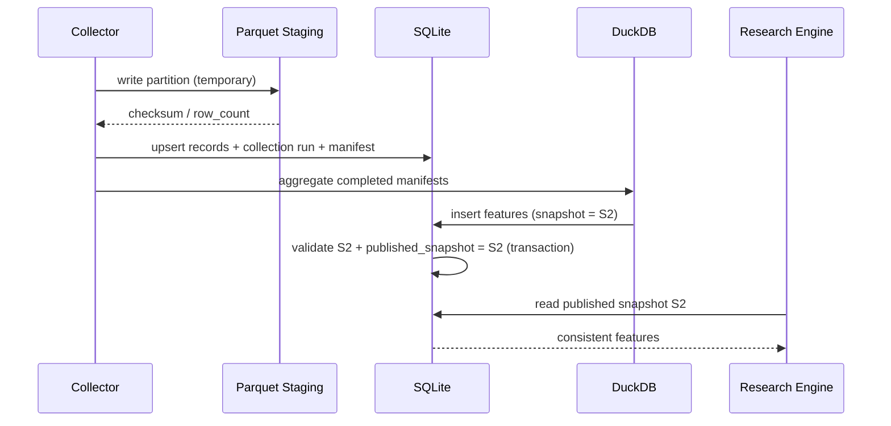

- 先にParquetを確定させる。SQLiteコミット失敗時は未参照ファイルとして検出して回収する。
- Feature生成を失敗したときはsnapshotを公開しない。
- 同じRecordの再取得で`records`はupsert、`record_sightings`は`(run_id,record_id)`で冪等化。
- 観測スナップショットは意味ある観測時刻ごとに重複排除する。APIが「最終更新日時」を提供する場合はそれを使う。提供されない場合は取得時刻を用いるが、「ソース計測時点不明」を保持する。
- `coverage`を欠損したFeatureは比較不能扱い。

## 5. ベンチマークで決める物理パラメータ

| パラメータ | 初期案 | 検証 |
|---|---|---|
| SQLite `WAL` | enable | Reader/Writer同時実行、checkpoint |
| FTS tokenizer | `trigram`から検証 | 日本語短語・英語混在の精度 |
| Parquet partition | `source/year/month` | 月/日/genre別、ファイル数とスキャン速度 |
| Parquet row group | DuckDB既定を試行 | scan speed、メモリ、圧縮 |
| TopicFeature materialization | 日次またはジョブ後 | 更新費用 vs クエリp95 |
| Hot index retention | 新旧複数snapshot | ディスク量、ロールバック |
| Large imports | 月別・必要列のみ | メモリ使用量、scan throughput |

## 6. 将来の移行条件

- 同時更新ワーカーが増えた場合、SQLiteの書込とスナップショット管理をPostgreSQLへ移行する。Domainのデータモデルは維持する。
- Parquetのパスは抽象化し、ローカルディスクからオブジェクトストレージへ変更可能にする。
- ベクトル検索は`SearchPort`の任意Adapterとして追加し、必須要件にしない。
- Schema migrationはAlembic等の導入可否を検討し、単体SQLiteでは明示的DDL migrationsでもよい。

## 7. 参考

- [SQLite Write-Ahead Logging](https://sqlite.org/wal.html)
- [SQLite FTS5](https://sqlite.org/fts5.html)
- [DuckDB Parquet](https://duckdb.org/docs/lts/data/parquet/overview)


---

<!-- 元のファイル: docs/EVALUATION_AND_TEST.md -->

# テスト・評価・ベンチマーク計画

- **版:** v1.0 / 2026-10-22
- **状態:** 設計上のテスト計画。実装・計測済みの結果ではない。

## 1. 品質仮説

1. 各分析は根拠Recordと収集範囲に遡れる。
2. 定期調査は未知Topicを検出しつつ、固定Topicの継続測定を壊さない。
3. サンプル不足や取得失敗を明示し、誤ったトレンド上昇を防げる。
4. SQLite Hot Index検索は分析用Parquetを読み込まず完結する。
5. クラウド/ローカルLLMに関わらず同じ構造化出力契約を返す。
6. データ・LLM APIへのアクセスなしにほとんどのテストを実行できる。

## 2. Test Pyramid

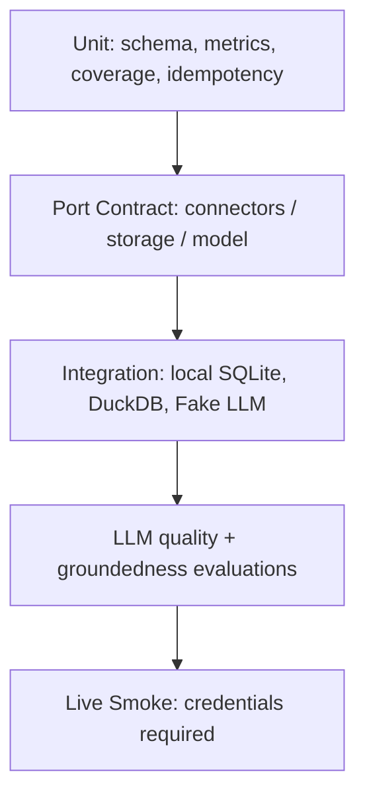

### Unit
- `published_at` と `collected_at`を別々に保存する。
- 同一ソース内のrank上昇は符号が正。
- 欠損値や`eligible_count=0`ならgrowthをnullとする。
- Star数の減少を負のDeltaとして扱える。
- Region unknownを`JP`に推定しない。
- Sourceの集合件数が違う期間を安易に比較しない。

### Contract
- `SourceConnector`は指定のCapability以外を実行しない。
- rate limit / timeout / 429を含む例外を共通エラー型に変換。
- `ChatModel`は型付き出力を返し、schema invalidなら失敗する。
- StoreはRecord Upsert、Observation append、検索、atomic published pointer更新をサポート。

### Integration
- Fixtureで`collect -> normalize -> evidence -> topic -> feature -> publish -> research`が通る。
- インポート中断時の次回再開。
- 新snapshot公開直前にReaderが旧snapshotを参照しても矛盾しない。
- 日本語FTS短語・英語の同義語の検索品質。

### Live smoke（手動／明示CI環境のみ）
- HNから1投稿取得。
- GitHub API Rate Limitを取得/解析。
- YouTubeはAPIキーやquotaが利用可能なときだけ1リクエスト。
- LLMは最小トークン呼び出し1回でPort契約を確認。
- Live smoke実行中に予期しない追加課金/API消費が発生しないようbudgetで制限。

## 3. 人手評価用質問セット（案）

| ID | 質問 | 成功条件 |
|---|---|---|
| E01 | 「この1週間の新しい開発者向けツールは？」 | Topicを列挙、HN/GitHubの観測範囲が明記される |
| E02 | 「日本で3Dプリンターは伸びている？」 | JPの情報源不足なら市場全体の断言を避ける |
| E03 | 「初心者のCADの難しさが課題では？」 | 支持・反証・不明点を分ける |
| E04 | 「投稿の伸びと売上の伸びは同じ？」 | 区別して説明する |
| E05 | 「海外のAI電話受付は日本でも流行している？」 | 地域・期間の比較可能性を確認する |
| E06 | 「この期間の上昇率は？」 | 正しい数値・分母・単位を根拠と紐付ける |
| E07 | 「このサービスへの批判を全部教えて」 | 収集範囲を限定し、全部という網羅性を主張しない |
| E08 | 「最新情報で判断して」 | staleなら追加取得か不可を宣言する |
| E09 | 「〇〇市場は存在しないんだよね」 | 観測0件を不存在としない |
| E10 | 「私の仮説は正しい？」 | 不足と反証を探索、安易に肯定しない |

評価コーパスは日本語・英語を含めて段階的に100問まで拡大。ソースへのアクセスが必要な質問と、合成データで完結する質問を分ける。

## 4. 定量メトリクス

| 項目 | 定義 | 暫定目標 |
|---|---|---|
| Citation Validity | 回答内Evidence IDが実在する割合 | 100%（テストセット） |
| Claim Support Rate | 人手評価で根拠が主張を支持する割合 | 上昇継続、数値はPoCで設定 |
| Numeric Consistency | 出力数値と保存数値が一致 | 100%（テストセット） |
| Coverage Disclosure | 範囲制限に該当する質問で注記した割合 | 100%（対象Fixture） |
| Retest Determinism | 同一snapshot+versionで数値一致 | 100%（決定的計算） |
| New Topic Precision | 候補から人手確認で妥当とされた割合 | Sourceごとに調整 |
| Unknown Rate | 証拠不足時に「不明」を返した割合 | 過剰確信の減少を目標 |

LLMによる主張評価の完全自動化は信用せず、人手アノテーションを評価の基準として利用する。

## 5. 性能検証

**データ規模:** 10万 / 100万 / 1000万のObservationに相当する合成データを生成。Record/Evidence数も別途測定。TikTok 460GB全体をMVPの必須ベンチマークにしない。

**測定環境記録:** CPU, RAM, SSD type, OS, Python/SQLite/DuckDB version, DB file size, Parquet row group / file count, cache warm/cold。

| ベンチID | 処理 | 計測 |
|---|---|---|
| B01 | 最新snapshotのTopic top 20 | p50/p95、rows scanned |
| B02 | 指定TopicのEvidence取得 | p50/p95、Query Plan |
| B03 | 日本語の課題語検索FTS | p50/p95、適合率/再現率 |
| B04 | 7日→30日窓の特徴量再計算 | CPU時間、メモリ、I/O |
| B05 | Parquet列選択+期間filter | scanned bytes、elapsed |
| B06 | 収集中の同時read | p95、SQLITE_BUSY件数 |
| B07 | Crash recovery / snapshot rollback | 復旧手順、データ整合 |
| B08 | Cloud vs Local LLM | end-to-end、LLM-only、トークン |

**設計上の初期SLO（実測ではない）:** Topic p95≤100ms、FTS p95≤300ms、LLMを除いたHot Retrieval p95≤1s。未達であればインデックスと集計の配置を修正。

## 6. 利用者価値の評価

単なる検索の正確性に加え、Botの実利用価値を測る。

- 未知のTopicの発見率（既知キーワードの焼き直しではないか）。
- 情報を読んで「もっと調べたい」と思った割合。
- ソースURLのクリック・根拠の検証可能性。
- 仮説検証によって確認・棄却・修正された仮説の件数。
- 特定ソースへの偏重度（開発者市場に偏り続けていないか）。

トレンド発見について「ユーザーの興味に合う情報のみ」を学習して未知の市場を見逃さないよう、新奇性評価を設ける。

## 7. テストデータと権利

- `fixtures/`は合成投稿・架空商品・架空トピック・権利上自由なサンプルのみ。
- 実SNS本文やTikTokデータを無条件でテスト配布しない。
- テスト結果の公開では検索式・対象期間・サンプル数・API条件を示すが、再配布権限のないデータは含めない。

## 8. GitHub CIの推奨ワークフロー

```text
PR: lint → types → unit → contract → offline integration
Nightly: benchmark-lite → compare with baseline
Manual only: external API smoke / large Parquet batch / paid LLM
Release: packaging → documentation links → offline smoke
```

無料枠・実行時間制限の影響を避けるため、大規模データセットや有料APIをプルリクエストCIの標準ワークフローに含めない。


---

<!-- 元のファイル: adr/ADR-0001-product-goals-and-boundaries.md -->

# ADR-0001: 事実中心・ユーザー主導の市場探索をプロダクトの中核とする

- **状態:** Accepted（利用者との議論で合意）
- **日付:** 2026-10-22
- **決定対象:** プロダクト目的、責務境界、品質要件

## 背景
最初は「日本で流行しているもの」「海外で稼いでいるビジネス」「新規事業」の市場調査Botとして検討した。その後、利用者が個人開発で実現可能な事業の着想を得ることが目的であり、企業売上・利益・市場規模を必須の判断基準とすると、小さな文化的・技術的トレンドを見落とすことが明確になった。事業仮説や課題仮説は利用者が主導する。

## 決定
1. 国内外の **関心・行動・新サービス・不満・検索・商品動向** を継続観測する。
2. システムは **観測事実（Observed）・分析（Derived）・未確認（Unknown）** を分離して返す。ユーザーが述べた仮説は別領域（User Hypothesis）として保持する。
3. 定期観測と、ユーザーの質問によるオンデマンド市場調査・仮説の根拠調査を提供する。
4. 課題や事業アイデアを自動的に断定・提案しない。明示的に依頼された場合のみ発想支援を拡張機能として検討する。
5. 売上・利益・資金調達額・TAMは必須の特徴量にしない。取得できる場合は補助的な情報に留める。
6. 個人開発との親和性は **ランキング補助情報** とし、トレンドを事前除外しない。

## 採用しなかった案
- 「高売上・高成長の企業をランキングする」: 小規模需要・文化の変化を捕捉しにくい。
- 「LLMが自動的にビジネスアイデアを生成する」: ユーザー主導の発想と異なり、事実と提案の境界が曖昧になる。

## 帰結
- トレンドの評価には投稿・検索・順位・レビュー・OSS活動など異種シグナルが必要。
- 出力には根拠リンク、対象期間、地域、収集条件、限界を必須とする。
- 探索範囲を広く保ちつつ、ユーザーにとっての関連性を説明する。

## 受入基準
- 市場概要と課題仮説の質問に、根拠と反証・未確認事項を付けて答えられる。
- 質問に含まれない事業案を既定で生成しない。

## 関連
[ADR-0002](ADR-0002-headless-core.md)、[ADR-0009](ADR-0009-research-query-routing.md)、[ADR-0010](ADR-0010-llm-boundaries.md)


---

<!-- 元のファイル: adr/ADR-0002-headless-core.md -->

# ADR-0002: UI非依存のHeadless Python Core / SDK / CLIとして公開する

- **状態:** Accepted
- **日付:** 2026-10-22
- **決定対象:** 公開形式とシステム境界

## 背景
利用者はDiscord、Slack、Web、その他任意の媒体から同じ調査機能を利用したい。特定のBot UI、OAuth認証、HTTPフレームワークをコアに含めると再利用が難しい。

## 決定
- 配布単位は **Python Package**。正規のプログラムインターフェースとして `ResearchEngine.research()`、`collect()`、`analyze()`、`report()` を提供する。
- CLIはSDKを呼び出す薄いアダプターとし、ローカル検証と運用に使う。
- Discord・Slack・Teams・Webなどの連携は本体のスコープ外。HTTP APIも必須にしない。
- `ResearchResult`、`TrendReport`、`JobStatus` などを **バージョン付き構造化出力** とする。表示用Markdownは任意のレンダラー責務。
- Core Domainはネットワーク、LLMベンダー、DB実装に直接依存しない。Ports & Adapters構成を採る。

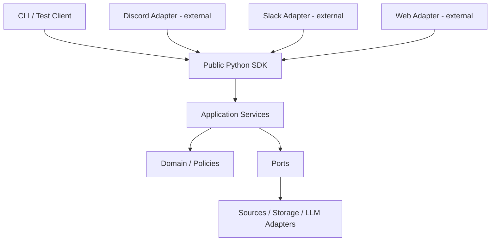

## 代替案
- Discord中心に実装: 導入が早いがプロダクトの境界が特定媒体に固定される。
- FastAPI必須: 導入環境と運用要件が増す。必要なら別配布のAPIアダプターを後から追加する。

## 帰結と注意点
- 非Pythonからの接続は利用者がHTTP/gRPCなどのブリッジを実装する（公式サンプルは将来可）。
- モデル形式の互換性（semantic versioning）と設定変更時の移行指針が必要。
- CLIコマンドに業務ロジックを書かない。

## 受入基準
- `python` からの呼び出しと `market-research ask ... --format json` が同じ実行結果スキーマを返す。
- SDKに`discord.py`等が必須依存として含まれない。


---

<!-- 元のファイル: adr/ADR-0003-source-selection-and-ingestion.md -->

# ADR-0003: 分析目的からData Sourceを選び、Capability付きConnectorで収集する

- **状態:** Accepted（方針）/ Proposed（具体的ソース構成と頻度）
- **日付:** 2026-10-22

## 背景
情報源をむやみに増やすとAPI制限・データの偏り・処理コストが増す。一方、開発者コミュニティのみでは一般消費者のトレンドを把握できない。取得できる情報と推論可能な事柄を紐付ける必要がある。

## 決定
1. **観測軸**を先に定義する: (a)新しい話題 (b)関心の変化 (c)新サービス (d)困りごと (e)商品・アプリ需要 (f)地域差。
2. 初期候補をHN・GitHub・YouTube・楽天市場とする。TikTok大規模データは別ADRの任意バッチ。Product Hunt・Reddit・Trends等は利用条件・資格を確認したオプション。
3. Connectorは `periodic` / `search` / `batch` / `metrics_refresh` などのCapability、レート制限、認証、利用条件、データ保持条件、標本範囲を自己記述する。
4. Collectorは定義済み `CollectionSpec` に基づき対象範囲・検索語・地域・取得窓・ページネーションを実行する。未対応機能は明示的に返す。
5. Sourceごとに収集ジョブの `coverage`（検索式、カテゴリ、地域、取得期間、取得上限、失敗ページ数）を保存する。

## 入力候補と実装判断
| ソース | 初期目的 | 注意 |
|---|---|---|
| Hacker News | Show/Ask HN・コメントから技術・課題を探索 | 開発者偏重。ランキングで全投稿代表を名乗らない |
| GitHub | 新規OSS・スター推移・Issues | Search上限・検索語バイアス・スター≠利用者 |
| YouTube | 地域別人気・動画指標・話題 | quota/検索バイアス、動画タイトルから現実行動の断定不可 |
| 楽天市場 | 日本の商品ランキング順位変化 | ランキング≠市場売上高、ジャンル範囲の偏り |
| Product Hunt | 新サービス（任意） | 原則非商用API。公開利用前に用途と条件を確認 |

## データ取得の境界
- **定期収集**:既知ソース・カテゴリ・クエリについて履歴取得。
- **オンデマンド**:指定されたトピックについて許可済みConnectorで追加検索。
- **バッチ**:既存大規模ファイルから必要列・期間を抽出。
- 全市場を網羅できると主張しない。未観測=存在しないではない。

## 代替案
- ニュースAPIだけ:トレンド初期と小規模の課題を捉えにくい。
- 全データを日次フルクロール:権利・帯域・コスト上不適切。

## 参照（確認日 2026-10-22）
- HN公式API: https://github.com/HackerNews/API
- GitHub検索API: https://docs.github.com/en/rest/search/search
- YouTube Videos list: https://developers.google.com/youtube/data/reference/rest/v3/videos/list
- YouTube quota: https://developers.google.com/youtube/data/determine_quota_cost
- 楽天ランキングAPI: https://webservice.rakuten.co.jp/documentation/ichiba-item-ranking
- Product Hunt API: https://api.producthunt.com/v2/docs


---

<!-- 元のファイル: adr/ADR-0004-tiktok-optional-batch.md -->

# ADR-0004: TikTok 56億件データを任意バッチ分析ソースとして扱う

- **状態:** Accepted（任意・非同梱）/ Proposed（分析パイプライン）
- **日付:** 2026-10-22

## 背景
利用者から `datasocial/tiktok-5.6B-videos` を流行観測のデータソースとして提案された。データセットは約5,598,141,717行、約460GB、月別Parquet、CC BY-NC 4.0として案内されている。現在の市場をリアルタイムに観測する公式のライブAPIではない。

## 決定
- データセットは **OSS本体・テストフィクスチャに同梱しない**。利用者が取得資格・使用目的・ライセンス・プラットフォーム側条件を確認して明示的に有効化する。
- Parquetの必要列（`video_id`, `posted_at`, `country`, `language`, `caption`, `hashtags`, `on_screen_text`, `views`, `likes`, `comments`, `shares`, `saves`, `stats_updated_at`）だけを取得・スキャンする。
- まず限定された月と地域を用いた小規模検証から開始。日×国×タグの件数と、サンプル境界を記録する。
- `posted_at`（投稿時刻）と`stats_updated_at`（反応の集計時刻）を分けて扱う。単一スナップショットの再生数から厳密な増加速度を算出しない。
- `country` は動画の地域属性であり視聴者地域ではない。Creatorを一意識別する投稿者IDが公開カラムに明示されていないため、投稿者数の広がりは算出しない。
- スナップショットの更新状況は保証されない。最新動向の定期収集は独立したソースを使う。

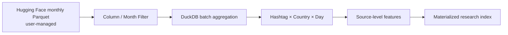

## リスク
- 取得元・再配布の権利上、派生集計の公開が許容されるか用途ごとに確認する必要がある。
- データ収集の偏りと欠損、ゼロ値の意味、収集時の地域偏りを検証する。
- `caption`等の個人情報・著作物を無制限に保持・出力しない。

## 非採用
- データ全体を常時SQLiteへ投入する。
- 「56億件=TikTok全体」と見なして国別市場規模や普及率を断定する。

## 参照
- Dataset card: https://huggingface.co/datasets/datasocial/tiktok-5.6B-videos
- ライセンス: https://creativecommons.org/licenses/by-nc/4.0/


---

<!-- 元のファイル: adr/ADR-0005-evidence-provenance.md -->

# ADR-0005: 原記録・観測値・証拠・分析を独立エンティティに分離する

- **状態:** Accepted
- **日付:** 2026-10-22

## 背景
SNSでの発言、投稿数、第三者の推測、LLMの要約を同じ「事実」として保存すると、出典追跡と反証が不可能になる。時系列データでは投稿日と数値を取得した時点が異なる。

## 決定
- `Source`（由来と利用条件）、`CollectionRun`（収集条件/網羅範囲）、`Record`（元の情報単位）、`Observation`（測定スナップショット）、`Evidence`（出典に紐づく最小命題）、`Analysis`（導出結果）、`AnalysisEvidence`（根拠との関係）を分割する。
- `Evidence.kind`は `measured_value`, `reported_statement`, `documented_attribute` 等。ユーザー仮説は `UserHypothesis` として別管理。
- 各Evidenceは record ID、URL、ソース上の位置（パラグラフ等、取得可能な範囲）、収集日時、命題、抽出方式/モデルバージョンを持つ。
- `Analysis`は `analysis_version`, `input_coverage_ids`, `computed_at`, `limitations` を持つ。**集計結果の内容が変わる場合、過去分析を黙って上書きしない**。
- 取得/保持が禁止された本文は保存せず、許可されたメタデータと参照を保存する。

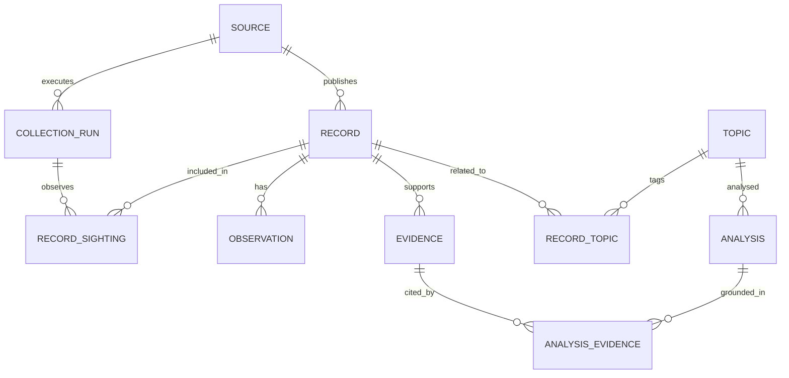

## トレードオフ
正規化された表が増えるため実装負担は増えるが、数値の変更履歴、出典確認、分析バージョン管理、API依存変更に耐えやすい。

## 受入基準
- 任意の分析から、対応するEvidence・原Record・取得ジョブ・URL・観測日時にたどれる。
- `published_at`, `observed_at`, `collected_at` が混同されない。
- 同一Recordを再取得しても重複せず、Observationだけ追記できる。


---

<!-- 元のファイル: adr/ADR-0006-topic-identity.md -->

# ADR-0006: Topicを市場横断の結合キーとし、関係と異表記を別管理する

- **状態:** Proposed（用語同定の精度検証待ち）
- **日付:** 2026-10-22

## 背景
「3Dプリンター」「3D printing」など言語違いの話題を共通に集計したい。ただし「家庭用3Dプリンター」と「産業用積層造形」は同じではない。単純な埋め込み類似度だけで統合すると誤結合が生じる。

## 決定案
- `Topic(id, canonical_label, kind, created_at, status)` を採用し、`TopicAlias`で表記揺れと多言語別名を管理する。
- `TopicRelation`は `broader`, `narrower`, `related`, `same_as_candidate` の型を持つ。階層は木ではなく有向グラフで許容。
- `RecordTopic`は多対多。紐付け元（rule/LLM/human）とスコア、検証状態、分類モデルバージョンを保存する。
- LLMは**候補を提案する**が、統合は語彙・既存関係・高信頼ルールを通して制御し、低確度は別トピックとして保留。
- `topic_id`は表示名と無関係な不変ID。再分類時はマッピングを残す。

## 採用しなかった案
- Topicを生キーワードと同一視する: 同義語統合や意味的集約が困難。
- 類似度閾値だけで自動統合する: 異種市場の誤結合リスク。

## 性能面
- `record_topics(topic_id, record_id)` と逆向きの索引を整備。
- 注目Topicのみに対し日次集計をマテリアライズし、Topic再分類時は影響範囲だけ再計算。

## 再検討条件
- 100トピック程度の注釈済みサンプルを用意し、同義語統合精度・誤結合率を測定する。
- 多言語・多階層の検索品質が要件を満たさない場合はオントロジー/ベクトル検索を追加。


---

<!-- 元のファイル: adr/ADR-0007-source-aware-analytics.md -->

# ADR-0007: Source別特徴量 → 共通Trend Signal の二段階分析を行う

- **状態:** Proposed（実データで性能・妥当性を検証）
- **日付:** 2026-10-22

## 背景
投稿数、スター数、再生数、ランキングは意味が異なる。これらを一つの「人気スコア」に直接加算すると恣意的である。市場全体ではなく、各情報源で観測された変化を説明可能な形にする。

## 決定案
1. 情報源ごとに `SourceFeature` を計算する。例: HNの関連投稿件数、GitHubのスター増分、YouTubeの対象動画群の視聴指標、楽天のランキング変化、TikTokの国別投稿シェア。
2. 分析には `collection coverage`, 欠損、観測分母（可能なら）を渡す。
3. 共通のSignalは `growth`, `acceleration`, `novelty`, `persistence`, `breadth` に分解。情報源ごとに正規化し、変換方法とバージョンを記録。
4. 単発バズと継続性を区別する。観測点不足やAPI制限が発生した期間は「比較不能」とする。
5. 課題抽出は `actor / job_or_activity / friction / quote_ref / qualifier` を記録。**発言が存在した事実**と**課題が普遍的か**を分離。
6. Cross-source一致は別々の測定系で観測された信号として提示し、プラットフォームの絶対件数を足し合わせない。

## 指標例
- `mention_share(t) = matching_records(t) / eligible_records(t)` : 同一収集条件内のみ。
- `growth_log = log((share_current + epsilon)/(share_baseline + epsilon))` : 分母・最低件数・baseline長を固定。
- `ranking_delta = rank_previous - rank_current` : 正値なら上昇。ただし対象リストとランキング規則の変更を記録。
- `persistence = positive_growth_windows / eligible_windows` : 足りない期間は算出不可。

## 採用しなかった案
- 売上や利益だけで市場を選ぶ。
- 絶対再生数、スター数、商品順位を共通の意味に見立てる。
- 全ソースのランキングスコアをそのまま平均する。

## 受入基準
- 出力は `source_id, region, window, metric_definition, value, sample_size, coverage_id, limitations, algorithm_version` を含む。
- 取得件数が欠損した期間の成長を誤検出しない。


---

<!-- 元のファイル: adr/ADR-0008-storage-materialization.md -->

# ADR-0008: SQLite + Parquet + DuckDBを最適化された標準Storageとする

- **状態:** Proposed（採用候補、実測ベンチマークで確定）
- **日付:** 2026-10-22

## 背景
個人開発・セルフホストでは設定の容易さが重要。一方、日次・国別・話題別の分析と巨大Parquetデータの検索を、質問時にフルスキャンするとレイテンシーが大きい。何でもDBを差し替えられることより、標準経路の性能と再現性が重要。

## 決定案
- **Hot / SQLite**: Source、Record索引、Topic、Evidence、Analysis、ジョブ状態、最新の`topic_features`、FTS5検索。
- **Warm / Parquet**: 追記型Observations・日次集計・大型分析データ。パーティションは `source/year/month` を初期値とし、小さなファイルを定期結合する。
- **Analytical engine / DuckDB**: Parquetのカラム指向・フィルタを活かして集計・再計算。DuckDBネイティブDBファイルを複数プロセス同時書込みのシステムDBにはしない。
- **Cold**: 利用規約上許される原データ、ユーザー管理の外部データセット。
- `analysis_version` と `snapshot_id` を紐付けた事前計算インデックスを公開し、読者は完成済みsnapshotのみ参照する。

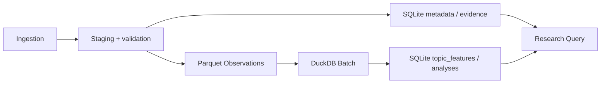

## 具体的な整合性戦略
1. ジョブIDを付け、一時領域に書き込む。
2. Parquetデータを検証し、確定配置する（ファイルハッシュを記録）。
3. SQLiteにmanifest/coverage/Record・Evidenceをコミットする。
4. DuckDBで特徴量を計算・検証し、SQLiteに新バージョンを一括登録する。
5. 参照する`published_snapshot`ポインタを原子的に更新する。
6. 失敗時は旧snapshotを維持し、未参照ファイルを後で回収する。

## 代替案
- PostgreSQL単体: 複数利用者や高並行性には優れるが初期導入負荷が高い。
- DuckDB単体: 低レイテンシーの逐次更新、FTS、運用メタデータ管理を初期用途で一元化しにくい。
- ベクトルDB必須: 現段階で必須でない。意味検索需要が確認されたら追加。

## 運用制約
SQLite WALは複数の読み手と一つの書き手を基本に設計する。大量並行書き込みやネットワークFSにはそのまま拡張しない。`EXPLAIN QUERY PLAN`、DuckDB `EXPLAIN ANALYZE`、実測p95で最終判断する。

## 参照
- SQLite WAL: https://sqlite.org/wal.html
- SQLite FTS5: https://sqlite.org/fts5.html
- DuckDB Parquet: https://duckdb.org/docs/lts/data/parquet/overview


---

<!-- 元のファイル: adr/ADR-0009-research-query-routing.md -->

# ADR-0009: 定期観測とオンデマンド調査を共通Research Engineで処理する

- **状態:** Accepted（2モード）/ Proposed（ルーター実装）
- **日付:** 2026-10-22

## 背景
利用者は市場レポートを定期的に受け取り、任意のタイミングで「〇〇市場は今どう？」「この課題があるのでは？どんな根拠？」と質問したい。定期レポート専用のパイプラインでは仮説検証に適応できない。

## 決定
- 同じEvidence Store / Topic / Featureを利用し、起動の違いを `run_scheduled_observation()` と `research(query)` に分ける。
- Plannerは質問を `market_overview`, `trend_compare`, `hypothesis_evidence`, `entity_lookup` 等の検証済みタスクへ分解する。
- Routerは優先順に (1)SQLite事前集計 (2)全文検索 (3)許可されたオンデマンドAPI検索 (4)必要時だけDuckDBバッチ を利用。
- データの鮮度と取得可能性を `fresh`, `stale`, `partial`, `unavailable` 等の構造化ステータスで示す。
- 仮説調査では支持・反証・不明点をそれぞれ探索し、**反証が見つからない=仮説正しい**とはしない。
- `ResearchResult`は根拠ID/URLと観測・取得時点、分析バージョン、coverageを返す。

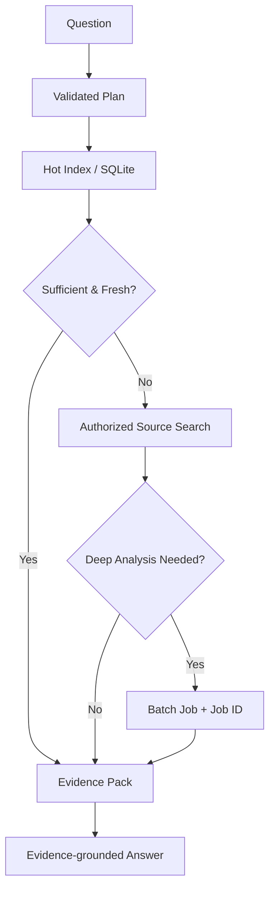

## 採用しなかった案
- LLMに任意SQL・任意HTTPを実行させる: 誤実行・漏洩・コスト・安全性の問題。
- すべて質問時にフル再集計: 実用的な応答性に欠ける。
- 古い観測データで最新と断定する: 品質要件に反する。

## 契約
同期応答が可能なら `ResearchResult(status='completed')`、長時間ジョブなら `ResearchResult(status='accepted', job_id=...)`。これはSDKのアプリ層の契約であり、UIプロトコルではない。


---

<!-- 元のファイル: adr/ADR-0010-llm-boundaries.md -->

# ADR-0010: LLMを交換可能な分析補助として使い、計測・検索を委任しない

- **状態:** Accepted
- **日付:** 2026-10-22

## 背景
API型・ローカルLLMのどちらでも利用したい。全工程を一つのエージェントフレームワークに依存すると、テストの再現性と移植性が損なわれる。

## 決定
- LLMは **Query Planning、Topic/Problem Extraction、Evidenceの要約、回答生成** に限定する。数値計算・DB更新・API実行は検証済みPython側で行う。
- `ChatModel`（構造化テキスト生成）と `EmbeddingModel`（任意）を別Portにする。Model capabilities（JSON schema, tool calling, context window, streaming等）を明示。
- 初期AdapterはOpenAI互換Chat APIとOllama向け。互換性は部分的であるため自動テストと代替ルートを持つ。
- LLMの出力は必ずPydantic等のschemaで検証し、無効な計画やEvidence IDは拒否/再試行する。
- Promptに渡す外部文章は未信頼データ。秘密情報、任意ツール操作、任意SQL実行の権限を与えない。
- Evidence Packの範囲にない数値を回答に作らせず、出典がない情報は`unknown`として扱う。

## 採用しなかった案
- LLMが全データソースに直接アクセスする汎用ReActエージェント。
- OpenAI固有のSDK型をパブリックAPIの戻り値にする。
- ベクトルDBと埋め込みを必須依存にする。

## 受入基準
- APIキーがなくてもFake LLMを用いた統合テストが通る。
- ローカルLLMでも同一の`ResearchResult`構造が返る。
- 不正なPlanner出力・存在しないEvidence参照を検出できる。

## 参照
- Ollama OpenAI互換API（subset）: https://docs.ollama.com/api/openai-compatibility


---

<!-- 元のファイル: adr/ADR-0011-jobs-consistency-and-scheduling.md -->

# ADR-0011: Schedulerを外置きし、ジョブを冪等・再開可能にする

- **状態:** Proposed
- **日付:** 2026-10-22

## 背景
同じコアをCLI、cron、クラウドジョブ、Botから呼び出す。大規模データ処理は長時間実行される一方、調査APIの読み取りを妨げてはならない。

## 決定案
- Coreが提供する操作は `collect(spec)`, `materialize(spec)`, `research(query)`, `get_job(job_id)`。
- スケジューリングそのものは `cron / GitHub Actions / cloud scheduler / 運用側` に委任し、Coreに常駐Schedulerを要求しない。
- ジョブは `queued / running / completed / failed / cancelled` と保存し、`idempotency_key`, `attempt`, `cursor`, `started_at`, `finished_at`, `error_type` を持つ。
- API制限はConnectorごとのBudget・Retry-After・指数バックオフ（jitter）で制御。再実行時はupsertとObservationの複合キーにより重複防止。
- 読み取りは**完成済みの分析snapshot**を参照し、分析中の部分結果は公開しない。
- 失敗を部分成功として記録できる（`coverage_incomplete`）。回収に必要なチェックポイントを残す。

## トレードオフ
- ジョブキュー製品を導入しない分、MVPでの並列度管理は簡易的になる。
- 後に複数ワーカー運用へ移行する場合はSQLite単独運用からPostgreSQL + queue等へ移す。

## 受入基準
- 同じCollectionSpecのリトライでRecordが二重にならない。
- ジョブを途中で落として再起動しても、前回の公開snapshotが使える。


---

<!-- 元のファイル: adr/ADR-0012-oss-license-and-data-rights.md -->

# ADR-0012: OSSコードのライセンスと取得データの権利を分離する

- **状態:** Accepted（分離方針）/ Proposed（最終OSSライセンス）
- **日付:** 2026-10-22

## 背景
利用者はプロダクトを無償・オープンソースとして公開予定。しかしOSSとしてのソフトウェアライセンスは、外部データやAPIの著作権・利用規約を上書きしない。非商用公開でもサービス提供・集約・再配布について別条件がある。

## 決定
- コードはOSI系のパーミッシブライセンス（Apache-2.0またはMIT、最終選択は公開前）で配布する。
- 取得データセット、APIキー、取得済み投稿本文、大規模キャッシュ等は**リポジトリにもpipホイールにも同梱しない**。
- 各ソースに `license`, `attribution_required`, `retention_policy`, `redistribution_policy`, `eligible_use`, `documentation_url`, `last_reviewed_at` を保持する。
- リポジトリのサンプルは権利上問題のない合成データを使用。
- 取得元が与える権利以上の保存・二次利用・公開をしない。利用条件に不確実性があればConnectorを既定無効とする。
- `datasocial/tiktok-5.6B-videos` は CC BY-NC 4.0。**コードがOSSであることは非商用条件への自動適合を意味しない**。利用者ごとに用途を確認する。
- 公開Botホスティングとセルフホストでは利用規約・データアクセス権限・個人情報管理の前提が異なる。MVPはセルフホスト中心。

## 採用しなかった案
- 収集したTikTok等の生データをGitHub Releasesで再配布。
- 公式APIを自動で有効化し、利用者ごとの利用規約確認を省略。

## 必須ドキュメント
`LICENSE`, `THIRD_PARTY_SOURCES.md`, `DATA_POLICY.md`, `SECURITY.md`。取得元を利用者に明示する。

## 参照
- TikTok Dataset: https://huggingface.co/datasets/datasocial/tiktok-5.6B-videos
- CC BY-NC 4.0: https://creativecommons.org/licenses/by-nc/4.0/
- Product Hunt API terms: https://api.producthunt.com/v2/docs


---

<!-- 元のファイル: adr/ADR-0013-quality-tests-and-benchmarks.md -->

# ADR-0013: データ品質・根拠忠実性・DB性能を独立して評価する

- **状態:** Proposed（評価基準は初期値）
- **日付:** 2026-10-22

## 背景
LLMの文章が自然でも、観測範囲の偏り・数値の不整合・出典の誤結合があれば市場調査として不適切。レイテンシーはモデルに依存するので、DBとLLMを分けて測る必要がある。

## 決定案
- **Unit**: 正規化、時刻、欠損、統計、冪等化、ランキング順位の符号。
- **Contract**: Collector、Storage、ChatModelの入出力と例外型、rate limit。Fake Adapterを使用。
- **Integration**:合成データで収集→保存→分析→Evidence検索→回答まで実行。
- **Evaluation**: 市場概要・仮説支持/反証・期間比較・データ不足を含む日本語質問セットを作成。人手レビューで主張と出典が対応するか評価。
- **Benchmark**: SQLite/FTS5/Parquetの件数規模別（例:10万/100万/1000万観測）でp50/p95とピークメモリを記録。
- **Reproducibility**: 固定seed、分析バージョン、Fixture、収集条件、モデル名を保存。

## 初期SLO（目標値であり未実測）
| 計測 | 目標案 |
|---|---|
| Hot Topic query | p95 100ms以内 |
| Evidence FTS query | p95 300ms以内 |
| LLM呼出し前の通常Retrieval | p95 1秒以内 |
| 不正Evidence IDの回答混入 | 0件（テストセット上） |
| 調査結果の再現 | 同じsnapshot・algorithm versionで同じ数値 |

LLM全体応答時間の固定SLOは現段階で設けない。非同期外部取得は別途時間予算を置く。

## 終了判定
- 実データでSLOが持続するか測定する。満たさなければ索引・Materialization・接続構成を見直す。
- 境界条件のテスト（標本が少ない、全件欠損、API部分失敗）を必須にする。


---

<!-- 元のファイル: adr/ADR-0014-scalability-and-packaging.md -->

# ADR-0014: 最適化済みLocal Standardを提供し、周辺だけ拡張可能にする

- **状態:** Accepted（方針）/ Proposed（配布プロファイル）
- **日付:** 2026-10-22

## 背景
利用者はスケーラビリティと導入容易性を両立したい。すべてのデータソース・ストレージを最初から任意交換可能にすると品質保証が難しい。一方、UIとLLMは特定実装に固定したくない。

## 決定
- 公式の標準構成として `SQLite + FTS5 + DuckDB + Parquet` を統合して提供し、移行先DBは拡張候補とする（詳細はADR-0008）。
- Data Collector/LLM/Renderer/SchedulerはPort経由で拡張可能にする。データ・Storageの整合性は **公式Reference Implementation** をまず重点検証。
- 配布形態: `pip install ...` でCore、extrasでCLI・各ソース・モデルSDKを導入。Dockerはoptionalサンプル。
- Profile: `lite`（開発者ソース）、`consumer`（YouTube/楽天）、`research`（大型バッチ）、`custom`（個別設定）。`full` は権利やAPI資格を満たす場合のみ有効化。
- 高並行性が必要なら `PostgreSQL + object storage + worker queue` へ移行できる境界を設けるが、初期実装しない。

## 代替案
- マイクロサービス/Kubernetesを初期導入する: MVPの負担過多。
- DuckDB・SQLiteに多数のプロセスが直接同時書き込みする: 同期リスクが高い。

## 受入基準
- APIキーなしで `market-research doctor`, `market-research ask --fixture` が実行できる。
- 新規Collectorの追加でCore Domain修正が不要。
- Headless SDKの出力形式は媒体非依存。


---

<!-- 元のファイル: adr/ADR-0015-security-privacy-and-prompt-injection.md -->

# ADR-0015: 未信頼データ・秘密情報・ユーザー仮説を分離する

- **状態:** Proposed（OSS公開時の基準）
- **日付:** 2026-10-22

## 背景
収集したWebコンテンツは第三者が自由に書き込める。情報源の内容をLLMへの命令として扱うと、プロンプトインジェクションや意図しないツール実行につながる。公開Botの利用者の市場仮説・会話履歴は公開してよい情報とは限らない。

## 決定案
- Web取得テキストは「未信頼の証拠」としてLLMに渡し、System/Developer指示に昇格させない。
- Connectorのリクエスト対象は許可リスト、TLS、URLの妥当性、レート制限、タイムアウトで制御。
- LLMからのTool Callは列挙した動作のみ、スキーマ検証後に実行。生SQL・シェル・任意URLアクセスを禁止。
- APIキーは環境変数・秘密情報管理に保存。ログにトークン・全文会話・個人情報を既定で残さない。
- UserHypothesis/Sessionは原則ローカル保存・明示的opt-in。第三者間で共有しない。
- 保存期間・削除ポリシーはソース別・データ分類別に設定。ライセンスだけでなくプライバシー・元サイトの規約も確認。
- OSS Connectorプラグインは任意コード実行に等しいため、既定では第三者Entry Pointを自動ロードしない。

## 非目標
- MVPはマルチテナントSaaSを提供しない。認証や権限分離の本格実装はホスト側責任。

## 受入基準
- コーパス内の「内部情報を送れ」等の文章に応じて外部通信が起きない。
- ログにAPIキーや収集禁止本文が漏れない。


---

<!-- 元のファイル: adr/ADR-0016-discovery-vs-monitoring.md -->

# ADR-0016: 未知の市場発見と既知Topicの監視を別パイプラインとして扱う

- **状態:** Proposed（探索精度の評価待ち）
- **日付:** 2026-10-22

## 背景
既知のキーワードだけを追跡すると、その時点で想定していない新しい習慣・商品・分野を発見できない。一方、すべての投稿を逐次LLM分類するとコストが大きい。

## 決定案
- **Discovery**: 各ソースの新着・上昇中・カテゴリ別データから未知Topic候補を抽出。単語・ハッシュタグ・タイトル・クラスタの変化点を検出して候補化。
- **Monitoring**: 既知Topicについて、比較可能な同一収集設定で指標を継続取得。信頼できる時系列を維持する。
- Discovery候補は `topic_candidate` として保存し、一定の件数・継続期間・複数根拠でTopic登録。条件を満たさない候補も短期間保存し、後から再評価できる。
- 推薦では新奇性と既知の関心を分離する。たとえば70/30の配分は実験可能な**初期仮説**であり固定要件ではない。
- 収集対象の全件数/既知クエリの偏りをCoverageとして提示する。観測0件を需要0と見なさない。

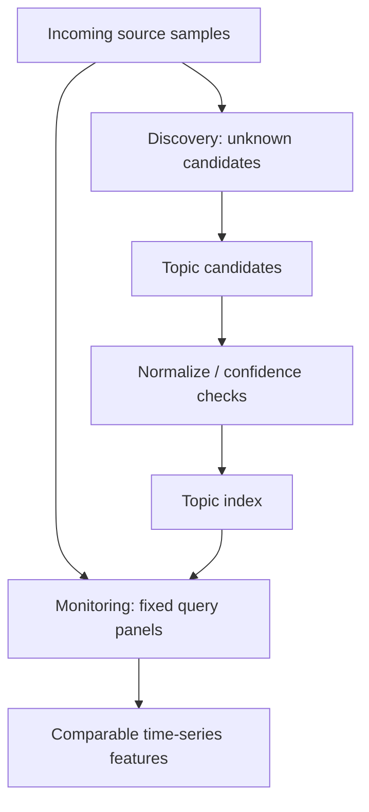

## 検証方法
- 既知Topicだけのモデルとの比較で、新規Topic検出数、誤検出率、利用者が興味を持った割合を測定。
- キーワード・カテゴリの固定パネルに依存しすぎていないか定期的に点検。

